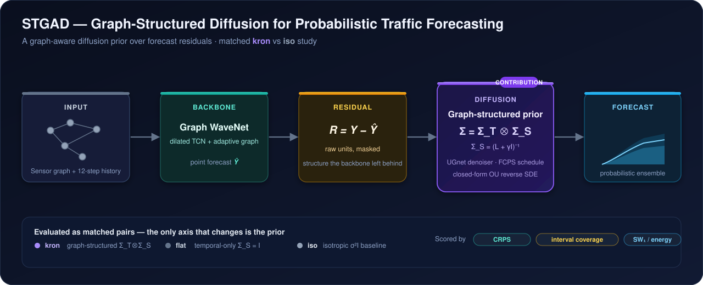

<div align="center">

<h1>STGAD</h1>

<p><b>Graph-Structured Diffusion for Probabilistic Spatio-Temporal Traffic Forecasting</b></p>

<p>
  
  
  
  
  
  
  <a href="LICENSE"></a>
</p>

</div>

STGAD models the **uncertainty** of a traffic forecast, not just its point value. A deterministic backbone (Graph WaveNet) predicts the mean; a **graph-aware diffusion model** then learns the distribution of what the backbone gets *wrong* — the residual `R = Y − Ŷ` — and turns a single prediction into a calibrated probabilistic forecast. The thesis contribution is the diffusion **prior**: a Kronecker covariance `Σ = Σ_T ⊗ Σ_S` with `Σ_S = (L + γI)⁻¹` that bakes the road graph and temporal smoothness directly into the noise process, tested head-to-head against an isotropic baseline.

<p align="center">
  
</p>

<p align="center"><sub><b>Figure 1.</b> From a single-point forecast to a calibrated predictive distribution, in two stages.</sub></p>

## Why a structured prior

Most diffusion forecasters corrupt the signal with plain isotropic noise (`σ²I`), which ignores that neighbouring sensors and adjacent time steps are correlated. STGAD's claim is that a prior shaped by the problem's geometry should produce **sharper, better-calibrated** forecasts:

- **Residual, not raw signal.** Diffusing `R = Y − Ŷ` (raw units, masked at missing sensors) lets the model concentrate capacity on the part of the signal that is genuinely stochastic, with the backbone handling the predictable mean.
- **Graph in the covariance.** The spatial factor `Σ_S = (L + γI)⁻¹` uses the normalised graph Laplacian `L`, so noise respects the road network; the temporal factor `Σ_T` encodes within-window smoothness. Together: `Σ = Σ_T ⊗ Σ_S`.
- **A controlled study.** Every experiment is a **matched pair** — `kron` (structured) vs `iso` (isotropic) vs `flat` (temporal-only) — sharing the same backbone, residuals, denoiser, schedule and seed. The *only* thing that changes is the prior, so any difference in the metrics is attributable to it.
- **Closed-form reverse SDE.** Because the per-eigenmode dynamics are a linear Ornstein–Uhlenbeck process, the ancestral sampler is exact, making per-epoch sampled-CRPS model selection affordable (≈10–25 s vs minutes for an EM sweep).

## Datasets

Six windowed datasets (12-step in / 12-step out) are rebuilt from scratch with baseline-faithful protocols. Provenance, SHA-256s and splits are documented in [`DATA_README.md`](DATA_README.md).

| Variant | Nodes | Signal | Units | Split | Lineage |
|---|---:|---|---|---|---|
| `metrla`  | 207 | speed | mph | 70 / 10 / 20 (windows) | DCRNN / Graph-WaveNet |
| `pemsbay` | 325 | speed | mph | 70 / 10 / 20 (windows) | DCRNN / Graph-WaveNet |
| `pems04f` | 307 | flow  | veh/5min | 60 / 20 / 20 (time) | ASTGNN / SpecSTG |
| `pems04s` | 307 | speed | mph | 60 / 20 / 20 (time) | ASTGNN / SpecSTG |
| `pems08f` | 170 | flow  | veh/5min | 60 / 20 / 20 (time) | ASTGNN / SpecSTG |
| `pems08s` | 170 | speed | mph | 60 / 20 / 20 (time) | ASTGNN / SpecSTG |

## Quick start

Requires Python 3.11+. METR-LA fits comfortably on a single GPU (or Apple-Silicon MPS); the full six-dataset grid is designed for a SLURM cluster (see [DAIC workflow](#running-on-a-slurm-cluster-daic)).

```bash
# 1. Install
git clone https://github.com/sserkanakin/stgad.git && cd stgad
python3.11 -m venv .venv && source .venv/bin/activate
pip install -e ".[dev]"          # core + pytest/jupyter · add [viz] for the dashboard, [hdf] to re-read raw .h5

# 2. Fetch raw data + the vendored backbone (both are gitignored, pulled on demand)
bash scripts/download_data.sh    # METR-LA/PEMS-BAY from Zenodo + DCRNN adjacency; clones Graph-WaveNet @6b162e8
python scripts/build_datasets.py --all   # raw → data/processed/<variant>/ (uniform + GWN-native views)
python scripts/verify_datasets.py        # spec-gate checks + summary table
```

> **PEMS04/08** raw arrays come from ASTGNN — see [`DATA_README.md`](DATA_README.md). The torch ≥ 2 Graph-WaveNet `Conv1d → Conv2d` fix is documented in [`THIRD_PARTY_PATCHES.md`](THIRD_PARTY_PATCHES.md) and also applied at runtime by `src/backbones`.

```bash
# 3. Train the backbone and extract residuals (example: METR-LA)
python third_party/Graph-WaveNet/train.py \
    --data data/processed/metrla/gwn_native \
    --adjdata data/processed/metrla/gwn_native/adj_mx.pkl \
    --num_nodes 207 --in_dim 2 --seq_length 12 \
    --gcn_bool --addaptadj --adjtype doubletransition --null_val 0.0

python scripts/gwn_extract_residuals.py --variant metrla --seed 42 \
    --checkpoint results/backbone/metrla/seed42/best.pth   # → results/residuals/metrla/seed42/*.npz

# 4. Train the residual diffusion — the matched kron-vs-iso pair
python scripts/train_diffusion.py --dataset metrla --prior kronecker --spatial structured --seed 42   # the contribution
python scripts/train_diffusion.py --dataset metrla --prior isotropic  --seed 42                        # the baseline

# 5. Evaluate (prints the kron-vs-iso comparison table)
python scripts/eval_diffusion.py --all
```

## How it is evaluated

Scoring happens in **raw units on the residual** (the backbone term cancels per point, so the comparison is clean), across three complementary axes:

| Axis | Metric | Question it answers |
|---|---|---|
| Sharpness + calibration | **CRPS** (fair / energy form) | Is the whole predictive distribution good? |
| Point accuracy | MAE / MSE of the ensemble mean | Did the mean stay competitive? |
| Interval calibration | Winkler interval score + empirical coverage | Are the uncertainty bands honest? |
| Distributional fidelity | sliced-Wasserstein-1, energy distance | Does the sample cloud match the true residuals? |

Model selection, early stopping and the LR schedule all key off **sampled-forecast CRPS on EMA weights** (not the raw denoising loss, which is ~93% irreducible noise — see the analysis in [`DECISIONS.md`](DECISIONS.md)). The shipped checkpoint is `best_crps.pt`.

<details>
<summary><b>Method details — forward SDE, schedules, and the sampler</b></summary>

<br/>

- **Backbone (stage 1).** Graph WaveNet (dilated temporal convolutions + an adaptive adjacency) produces the deterministic forecast `Ŷ`. GCN-order-1 and raw-MLP backbones are included as ablation arms.
- **Forward process.** A continuous-time, graph-coloured diffusion whose stationary covariance is `Σ = Σ_T ⊗ Σ_S`. The denoiser (a UGnet, adapted from DiffSTG) predicts the clean residual `R₀` (x0-prediction) under an SNR-weighted masked MSE loss.
- **Noise schedule.** `kron` uses FCPS (GAD-literal, S = 7, α = 4, c_min = 0.1); `iso` uses a matched linear-rate schedule carrying the same total heat, so the two arms are comparable.
- **Reverse process.** An Euler–Maruyama reverse SDE for test-time ensembles, plus a closed-form ancestral sampler (exact for the linear per-mode OU SDE) that makes per-epoch validation cheap.
- **Pure-signal arm.** A `raw` backbone-free mode diffuses the future signal directly, conditioned on history (DiffSTG-style), as an additional comparison point.

Full specification with file:line references: [`docs/diffusion_method.md`](docs/diffusion_method.md) · evaluation protocol: [`docs/evaluation_protocol.md`](docs/evaluation_protocol.md) · forward-process analysis: [`docs/forward_analysis.md`](docs/forward_analysis.md).

</details>

<details>
<summary><b>Repository layout</b></summary>

<br/>

```
stgad/
├── src/
│   ├── data/          # residual dataset, adjacency / Laplacian, archive import
│   ├── diffusion/     # forward (FCPS), denoiser (UGnet), prior, reverse SDE, losses
│   ├── eval/          # CRPS, Winkler intervals, sliced-W1 / energy, forward analysis
│   └── utils/         # EMA, checkpointing, config, seeding, W&B setup
├── scripts/
│   ├── build_datasets.py / verify_datasets.py    # from-scratch, verifiable data build
│   ├── gwn_extract_residuals.py                   # residuals from the vendored GWN repo
│   ├── train_diffusion.py / eval_diffusion.py     # train + evaluate the diffusion stage
│   ├── forward_analysis_*.py / plot_*.py          # diagnostics + thesis figures
│   └── daic/                                       # SLURM submission + sync for the TU Delft cluster
├── configs/           # per-dataset + backbone YAML
├── docs/              # method spec, evaluation protocol, forward analysis
├── tests/             # datasets, denoiser, forward FCPS, reverse SDE
├── DATA_README.md     # dataset provenance, hashes, build commands
├── DECISIONS.md       # dated methodology decision log (with the evidence behind each)
└── THIRD_PARTY_PATCHES.md   # durable record of edits to the gitignored vendored repos
```

</details>

<details id="running-on-a-slurm-cluster-daic">
<summary><b>Running on a SLURM cluster (DAIC)</b></summary>

<br/>

The full six-dataset × {kron, flat, iso} × seeds grid runs on TU Delft's DAIC cluster. One friendly entry point wraps the tested submission scripts:

```bash
scripts/run.sh profile metrla kron     # short profiled run (real memory peak, ~40 batches)
scripts/run.sh train   metrla 42 kron  # one full diffusion run
scripts/run.sh all                     # idempotent: submit every missing stage
```

Code travels via git; data is synced with content-verified `rsync` (`scripts/daic/sync_*.sh`). Cluster-local config lives in `scripts/daic/env.sh` (gitignored).

</details>

## Tests

```bash
pytest          # datasets, denoiser, forward FCPS, reverse SDE
```

## Acknowledgements

Built on the shoulders of [Graph WaveNet](https://github.com/nnzhan/Graph-WaveNet) (backbone), [DiffSTG](https://github.com/wenhaomin/DiffSTG) (UGnet denoiser), and the [DCRNN](https://github.com/liyaguang/DCRNN) / [ASTGNN](https://github.com/guoshnBJTU/ASTGNN) / [SpecSTG](https://github.com/lequanlin/SpecSTG) dataset lineages. Vendored code is kept in `third_party/` (gitignored) with every edit logged in `THIRD_PARTY_PATCHES.md`.

<div align="center"><sub>MSc thesis research · Delft University of Technology · <a href="https://sserkanakin.github.io">sserkanakin.github.io</a></sub></div>
