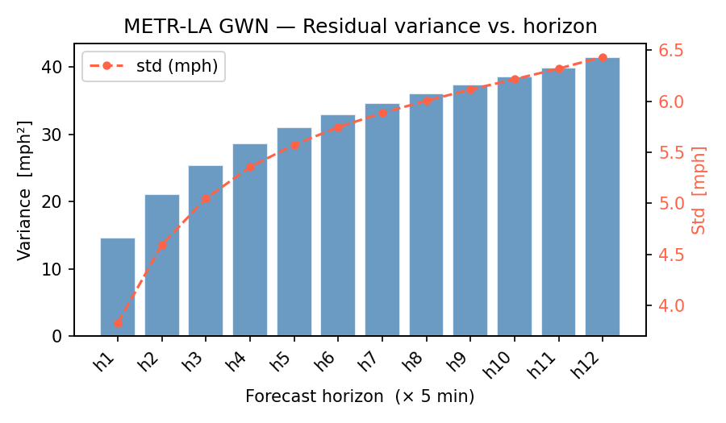
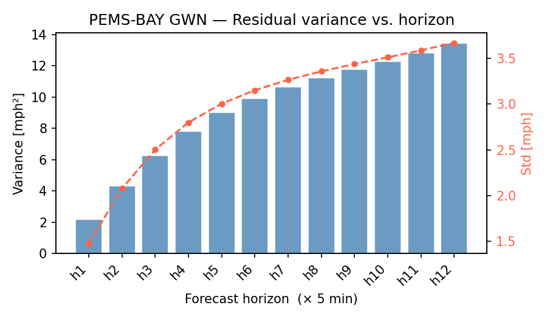
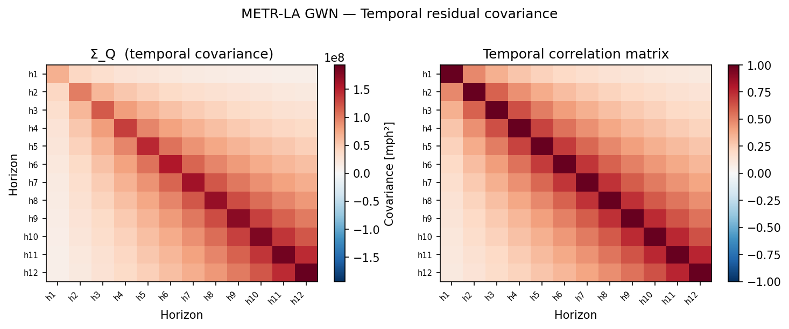
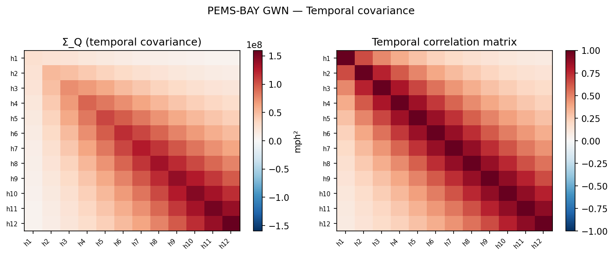
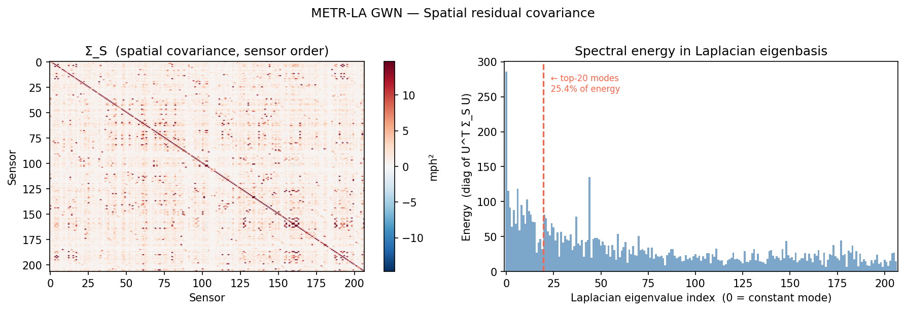
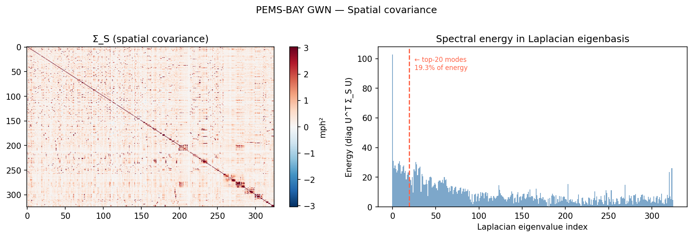
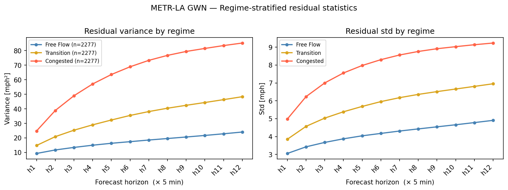
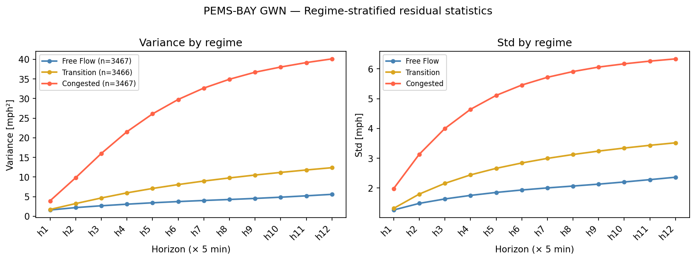

# Thesis Progress Report
**Structured Residual Diffusion for Probabilistic Spatiotemporal Traffic Forecasting**
Generated: 2026-04-24

---

## Overview

This report covers Phases 0–3 of the thesis implementation. The goal of these phases is to establish a working backbone pipeline, extract backbone residuals, and validate that the residuals have the structure required to justify the Kronecker-structured prior — the central thesis contribution.

**Bottom line: all three go/no-go checks from Phase 3 pass. The Kronecker prior is justified and Phase 4 (prior fitting) can proceed.**

---

## Phase 0 — Infrastructure

Completed. Full project scaffold:

- `src/` package with `data/`, `backbones/`, `diffusion/`, `utils/` modules
- `configs/` with backbone and dataset YAML configs
- `scripts/` entry points for each pipeline stage
- `tests/` — 33 passing tests
- `src/utils/seed.py` — deterministic seeding (seeds 0–4)
- `src/utils/config.py` — config loading + `hash_config()` for deterministic run IDs
- `src/utils/checkpoint.py` — save/load with RNG state capture for exact resume
- `src/utils/wandb_setup.py` — `init_wandb()` with `.env` auth, offline fallback, deterministic run IDs
- `DECISIONS.md` — design decisions log
- `RUNBOOK.md` — copy-pasteable execution instructions for each phase

---

## Phase 1 — Data & EDA

Completed. Both datasets preprocessed and analysed.

### Datasets

| Dataset | Sensors | Split (train/val/test) | Mean speed | Missing |
|---------|---------|----------------------|------------|---------|
| METR-LA | 207 | 70 / 10 / 20 % | ~54 mph | ~7% |
| PEMS-BAY | 325 | 70 / 10 / 20 % | ~62 mph | ~0% |

Preprocessing produces per-dataset `.npz` files and a `scaler.yaml` (mean/std of x speed channel). The target `y` is never normalised at save time — only `x[..., 0]` (speed) is standardised.

### Key EDA findings

- **Temporal autocorrelation**: single AR(1) fit gave RMSE = 0.037; two-exponential mixture `α·ρ₁^k + (1-α)·ρ₂^k` gave RMSE = 0.011 on METR-LA — 3× improvement. This motivated upgrading the temporal prior from single-exponential to two-exponential.
- **Regime identification**: three traffic regimes identified via speed-based clustering — free flow, transition, congested — balanced across the test set.
- **Laplacian eigendecompositions** computed and saved for both datasets (`metrla_laplacian_eigs.npz`, `pemsbay_laplacian_eigs.npz`).

---

## Phase 2 — Backbone Training

### Architecture

Two backbone families:

**GWN (Graph WaveNet)** — dilated causal convolutions with adaptive adjacency matrix. Runs on MPS (Apple Silicon GPU). ~277K–279K parameters.

**DCRNN (Diffusion Convolutional RNN)** — graph diffusion convolutions with sequence-to-sequence architecture. Must run on CPU (sparse tensor MPS incompatibility). ~372K parameters. Weights created lazily on first forward pass — dummy forward required before `Adam()`.

### Results

| Backbone | Dataset | Best epoch | val/mae h12 | Target | Status |
|----------|---------|-----------|-------------|--------|--------|
| GWN | METR-LA | 60 / 100 | **3.25 mph** | 3.53 | ✓ beats target |
| GWN | PEMS-BAY | 99 / 100 | **1.91 mph** | 1.95 | ✓ within target |
| DCRNN | METR-LA | 12 / 100 | 3.34 mph | 3.10 | in progress |
| DCRNN | PEMS-BAY | 4 / 100 | 2.17 mph | 1.59 | in progress |

GWN beat or matched published reference numbers on both datasets, confirming the data pipeline and backbone wiring are correct. DCRNN is still training — early checkpoints have been extracted for pipeline testing and will be re-extracted once training completes.

The metric is **masked MAE at horizon 12** (60-minute-ahead forecast), computed in raw mph after inverse-transforming normalised predictions. Masking excludes sensors with missing readings (relevant for METR-LA, ~7% missing).

---

## Phase 3 — Residual Analysis

Residuals are `y_true − y_pred` in raw mph. Extracted for all three splits (train/val/test) for both GWN runs. All analysis below uses GWN train residuals, which are from a fully converged model and represent genuine irreducible uncertainty.

### Residual scale and bias

| Backbone / Dataset | Global mean | h1 std | h6 std | h12 std |
|-------------------|-------------|--------|--------|---------|
| GWN / METR-LA | −0.66 mph | 3.82 | 5.75 | 6.44 |
| GWN / PEMS-BAY | −0.13 mph | 1.48 | 3.15 | 3.67 |

Global means are close to zero — the backbone is approximately unbiased. The small negative bias on METR-LA (GWN slightly over-predicts) is worth a note in the thesis. PEMS-BAY residuals are roughly half the scale of METR-LA, consistent with Bay Area traffic being more regular.

---

### Figure 1 — Residual variance vs. horizon

**What it shows:** Empirical `Var(R_h)` and `Std(R_h)` per forecast horizon, bars = variance, line = std.

**Interpretation:** Variance grows monotonically from h1 to h12 on both datasets. For METR-LA, std increases from 3.8 mph (5 min ahead) to 6.4 mph (60 min ahead) — a 70% increase. For PEMS-BAY the increase is from 1.5 to 3.7 mph — 150%. A single fixed variance across all horizons would be badly miscalibrated: either too narrow at h12 or too wide at h1. This justifies the **horizon-dependent prior** where each horizon h gets its own variance scale `δ_h`.

**Go/no-go:** ✓ PASS (monotone growth on both datasets)

---

### Figure 2 — Temporal covariance structure

**What it shows:** Left panel — raw 12×12 covariance matrix `Σ_Q` where `Σ_Q[h₁, h₂] = E[R_{h₁} R_{h₂}]` averaged over all sensors and windows. Right panel — normalised to a correlation matrix.

**Interpretation:** The correlation matrix shows clear AR-type decay from the diagonal — adjacent horizons are strongly correlated, and the correlation fades as horizon distance increases. This is the fingerprint of a temporally smooth error process, where the backbone's forecast error at h=5 carries information about its error at h=6. The two-exponential mixture kernel `α·ρ₁^|h₁-h₂| + (1-α)·ρ₂^|h₁-h₂|` is motivated by this: a fast-decaying component captures the short-range horizon-to-horizon correlation, and a slower component captures the persistent overall trend error that carries across many steps.

---

### Figure 3 — Spatial covariance in Laplacian eigenbasis

**What it shows:** Left panel — raw N×N spatial covariance `Σ_S` (averaged across all horizons). Right panel — spectral energy `diag(U^T Σ_S U)` where U are the Laplacian eigenvectors sorted by eigenvalue, i.e. how much residual variance sits in each spatial frequency.

**Interpretation:** If errors were spatially random (no road network structure), the spectral energy would be roughly flat — every eigenmode would carry equal variance. Instead, the energy is concentrated in the low-frequency modes (small eigenvalue index = smooth spatial patterns corresponding to nearby sensors on the same road segment moving together). The top 20 modes capture 25.4% of total spatial energy on METR-LA and 19.3% on PEMS-BAY, with a clear decay. This is exactly the concentration expected under a graph-Laplacian GMRF prior: the prior assigns higher probability to smooth spatial patterns, and the data confirms the residuals are smoother than random.

PEMS-BAY shows a sharper concentration, consistent with the Bay Area highway network being more homogeneous (fewer arterials, more uniform freeway structure).

---

### Figure 4 — Variance by traffic regime

**What it shows:** Per-horizon residual std stratified by the three traffic regimes (free flow, transition, congested), using test split residuals and regime labels from Phase 1 EDA.

| Regime | METR-LA h1 | METR-LA h12 | PEMS-BAY h1 | PEMS-BAY h12 |
|--------|-----------|------------|------------|-------------|
| Free flow | 3.05 mph | 4.90 mph | 1.27 mph | 2.37 mph |
| Transition | 3.85 mph | 6.95 mph | 1.32 mph | 3.52 mph |
| Congested | 4.98 mph | **9.23 mph** | 1.98 mph | **6.33 mph** |

**Interpretation:** This is the central empirical motivation for the thesis. In congested conditions the backbone's 60-minute-ahead uncertainty is **roughly double** free-flow uncertainty — 9.2 vs 4.9 mph on METR-LA, 6.3 vs 2.4 mph on PEMS-BAY. A point-forecast model communicates none of this. A naive isotropic diffusion model would use the same uncertainty for every regime. The structured prior — by capturing the covariance structure of the residuals and how it changes with traffic state — is what enables the model to output wide, well-calibrated intervals during congestion and tight intervals during free flow. This is the hypothesis to be tested in Phase 6: structured prior > isotropic prior, especially in congested regimes.

---

### Kronecker separability check

| Dataset | Frobenius relative error | Verdict |
|---------|--------------------------|---------|
| GWN / METR-LA | **26.2%** | ✓ PASS (threshold < 40%) |
| GWN / PEMS-BAY | **12.5%** | ✓ PASS (threshold < 40%) |

This measures how well the full spatio-temporal covariance is approximated by a Kronecker product `Σ_Q ⊗ Σ_S`. A 26% error on METR-LA means the Kronecker structure explains about 74% of the total covariance — defensible for a prior, though the 26% residual cross-structure is worth acknowledging as a limitation. PEMS-BAY fits much better at 12.5%, consistent with its more regular traffic dynamics.

The appropriate thesis framing: "The Kronecker assumption is an approximation that trades modelling fidelity for tractability and interpretability. The empirical separability error of 26% on METR-LA and 12.5% on PEMS-BAY confirms it is a reasonable approximation, not an exact factorisation."

---

## Current Status

| Phase | Description | Status |
|-------|-------------|--------|
| 0 | Infrastructure, tests, utilities | ✓ Complete |
| 1 | Data preprocessing, EDA, regime labels, Laplacian eigendecompositions | ✓ Complete |
| 2 | Backbone training (GWN converged; DCRNN in progress) | ✓ / In progress |
| 3 | Residual analysis, all figures, all go/no-go checks | ✓ Complete |
| **4** | **Prior fitting — estimate α, ρ₁, ρ₂, β from GWN train residuals** | **Next** |
| 5 | Diffusion model implementation (SDE, denoiser, sampler) | Pending |
| 6 | End-to-end smoke test on Mac — structured vs isotropic prior | Pending |
| 7 | Full experiment matrix on Delft cluster (60 runs) | Pending |
| 8 | Analysis, tables, figures, thesis writing | Pending |

---

## Next Step — Phase 4: Prior Fitting

`scripts/fit_prior.py` will:

1. Load `gwn_metrla_train_seed0.npz` (and PEMS-BAY equivalent)
2. Fit **δ_h** — empirical `Var(R_h)` per horizon (already computed above)
3. Fit **α, ρ₁, ρ₂** — two-exponential temporal kernel by fitting the empirical ACF of the 12×12 correlation matrix
4. Fit **β** — spatial scaling via `scipy.optimize.minimize`, minimising Frobenius distance between `(β L + ε I)^{-1}` and the empirical `Σ_S`
5. Derive **σ** (SDE diffusion coefficient) from eigenvalue analysis
6. Save parameters to `results/prior_params/{dataset}.yaml`
7. Sanity check: draw 1000 samples from the fitted prior, compare empirical covariance to target

Go/no-go for Phase 4: prior sample covariance must match target. If it doesn't, the SDE implementation has a bug.
