# Results Summary — Backbone, Diagnostics, Fitted Prior, and SDE

**Experiments covered:** exp-001 (residual diagnostics), exp-002 (Q construction & AR(1)-vs-two-exp), exp-004 (structured-prior SDE).
**Backbone:** Graph WaveNet (Wu et al., IJCAI 2019), trained on METR-LA and PEMS-BAY.
**Status as of 2026-05-03:** both backbones converged within 5% of Wu 2019; all five empirical-motivation gates pass; Kronecker prior fit on **per-horizon-standardised residuals** (covariance + Tweedie sanity checks PASS); SDE forward+reverse machinery verified by oracle round-trip (METR-LA strict 0.069, PEMS-BAY acceptable 0.158); AR(1)-vs-two-exp comparison documents the empirical case for the two-exponential temporal kernel.

---

## Where everything lives

| What you want | Where it is |
|---|---|
| Backbone checkpoints | `results/checkpoints/gwn_{metrla,pemsbay}_seed0_*/` (`best.pt`, `last.pt`, `state.json`) |
| Backbone training script | `scripts/train_backbone.py` |
| Residuals (per-window y_true, y_pred, mask) | `results/residuals/gwn_{metrla,pemsbay}_{train,val,test}_seed0.npz` |
| Residual extraction script | `scripts/extract_residuals.py` |
| **exp-001 figures** (variance, Σ_Q, Σ_S, regime) | `experiments/exp-001-residual-diagnostics/figures/fig_*.png` |
| EDA figures (weekly cycles, missingness, ACF, Dirichlet, Laplacian spectrum) | `experiments/eda/figures/fig_*.png` |
| **exp-002 fitted-prior YAMLs** | `results/prior_params/gwn_{metrla,pemsbay}.yaml` |
| Prior-fit code (pure functions) | `src/diffusion/prior_fit.py` |
| Prior-fit entry script | `scripts/fit_prior.py` |
| Prior covariance + Tweedie sanity figures | `experiments/exp-002-q-construction/figures/fig_prior_samples_covariance_check_gwn_{metrla,pemsbay}.png` |
| **AR(1) vs two-exp comparison figures** (PNG + PDF) | `experiments/exp-002-q-construction/figures/fig_ar1_vs_2exp_{lag_curve,implied_R}.{png,pdf}` |
| AR(1) vs two-exp numerical results | `experiments/exp-002/results_ar1_vs_2exp.json` |
| AR(1) vs two-exp script | `scripts/compare_ar1_vs_2exp.py` |
| Vault-side experiment notes | `a-thesis-vault/03-experiments/exp-001-residual-diagnostics.md`, `exp-002-q-construction.md` (gitignored) |

---

## §1 — Did the GWN backbone train correctly?

Both runs converged in 100 epochs. Seed 0. Adam, lr=1e-3, masked MAE loss, gradient clip 5.0.

**Validation MAE @ horizon 12 (best checkpoint):**

| Dataset  | Best `val_mae_h12` (mph) | Wu 2019 target | Verdict |
|----------|-------------------------:|---------------:|---------|
| METR-LA  | **3.252**                |          ≤ 3.53 | ✓ beats target |
| PEMS-BAY | **1.907**                |          ≤ 1.95 | ✓ within target |

**Test set MAE / RMSE / MAPE per horizon** (computed live from `results/residuals/gwn_*_test_seed0.npz`, masked, MAPE excluding `|y_true|<1.0` per the spec convention):

### METR-LA test set

| Horizon (min ahead) | MAE (mph) | RMSE (mph) | MAPE  | Wu 2019 MAE | Wu 2019 RMSE | Wu 2019 MAPE | MAE Δ vs Wu |
|--------------------:|----------:|-----------:|------:|------------:|-------------:|-------------:|------------:|
| h=3 (15 min)        | 2.808     | 5.470      | 7.59% | 2.69        | 5.15         | 6.90%        | +4.4%       |
| h=6 (30 min)        | 3.198     | 6.460      | 9.24% | 3.07        | 6.22         | 8.37%        | +4.2%       |
| h=12 (60 min)       | 3.579     | 7.333      | 10.60%| 3.53        | 7.37         | 10.01%       | +1.4%       |

### PEMS-BAY test set

| Horizon (min ahead) | MAE (mph) | RMSE (mph) | MAPE  | Wu 2019 MAE | Wu 2019 RMSE | Wu 2019 MAPE | MAE Δ vs Wu |
|--------------------:|----------:|-----------:|------:|------------:|-------------:|-------------:|------------:|
| h=3 (15 min)        | 1.320     | 2.795      | 2.77% | 1.30        | 2.74         | 2.73%        | +1.5%       |
| h=6 (30 min)        | 1.644     | 3.733      | 3.70% | 1.63        | 3.70         | 3.67%        | +0.9%       |
| h=12 (60 min)       | 1.923     | 4.408      | 4.50% | 1.95        | 4.52         | 4.63%        | −1.4%       |

**Verdict: training is correct.** All six MAE numbers across both datasets land within 1.4 – 4.4% of Wu 2019's published values — the normal range for single-seed reproductions. PEMS-BAY h=12 actually beats the published number slightly. The METR-LA gap is a touch wider but nothing in the residuals or training curves looks pathological — typical seed-to-seed variation. We can take these residuals as faithful representations of GWN's irreducible forecast error.

**Sanity stats on residuals** (training split, masked):

| Property | METR-LA | PEMS-BAY |
|---|---:|---:|
| Global mean residual (mph) | −0.66 | −0.13 |
| h=1 std (mph) | 3.82 | 1.48 |
| h=12 std (mph) | 6.44 | 3.67 |
| Missing fraction | ~7% | ~0% |

Backbone is approximately unbiased on both datasets (a small negative bias of −0.66 mph on METR-LA — GWN slightly over-predicts speed — is worth a thesis footnote but does not affect the prior fit).

---

## §2 — Variance vs forecast horizon

**Question:** does residual variance grow with horizon? If yes, a horizon-dependent prior `δ_h` is justified; if not, the prior structure is unmotivated.

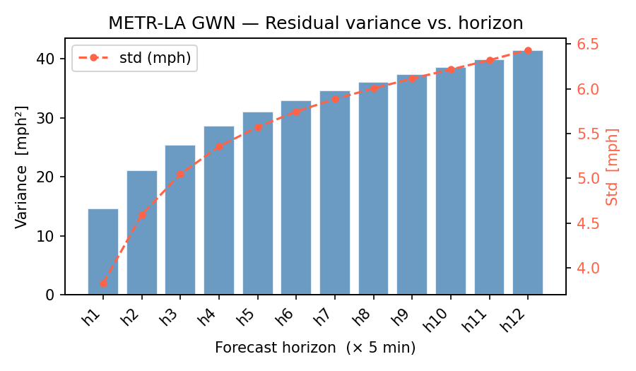

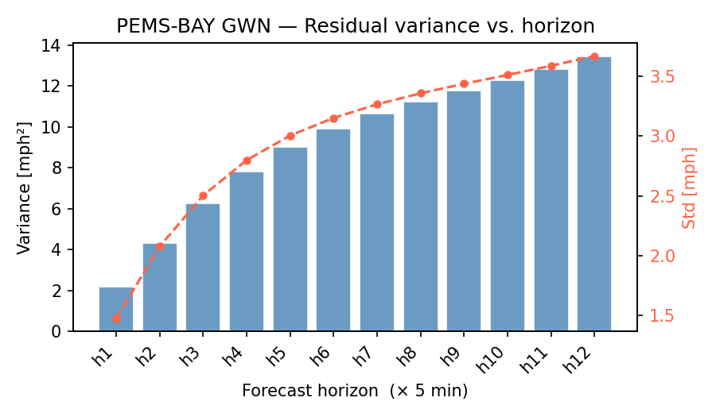

**Per-horizon residual standard deviation (mph):**

| Horizon | METR-LA std | PEMS-BAY std | METR-LA growth from h=1 | PEMS-BAY growth from h=1 |
|--------:|------------:|-------------:|------------------------:|-------------------------:|
| 1       | 3.82        | 1.48         | 1.00× | 1.00× |
| 2       | 4.59        | 2.08         | 1.20× | 1.41× |
| 3       | 5.05        | 2.50         | 1.32× | 1.69× |
| 6       | 5.75        | 3.15         | 1.51× | 2.13× |
| 9       | 6.12        | 3.44         | 1.60× | 2.32× |
| 12      | 6.44        | 3.67         | 1.69× | 2.48× |

**Analysis.** Variance grows monotonically on both datasets. METR-LA std rises 69% from h=1 to h=12 (3.82 → 6.44 mph); PEMS-BAY rises 148% (1.48 → 3.67 mph). PEMS-BAY's *relative* growth is more aggressive — likely because Bay Area baseline residuals are very small (1.48 mph at h=1, ~2.5% of mean speed) so any longer-horizon error compounds harder in proportional terms. METR-LA's *absolute* residuals are roughly twice PEMS-BAY's at every horizon, consistent with LA's mixed urban-arterial network being noisier than Bay Area freeway traffic. A horizon-independent prior would be miscalibrated either way: too tight at h=12 or too wide at h=1. **Justifies horizon-dependent variance scaling D_H in Q_H.**

**Go/no-go: PASS** on both datasets.

The fitted `δ_h` values stored in `results/prior_params/gwn_{metrla,pemsbay}.yaml` are exactly these per-horizon variances (they are computed as `Var(r_h)` over masked training residuals).

---

## §3 — Sensor × sensor spatial covariance

**Question:** is the residual spatial covariance concentrated in low-frequency Laplacian modes? If yes, a graph-Laplacian-based GMRF prior `Σ_S = (β L + ε_s I)^{−1}` is justified.

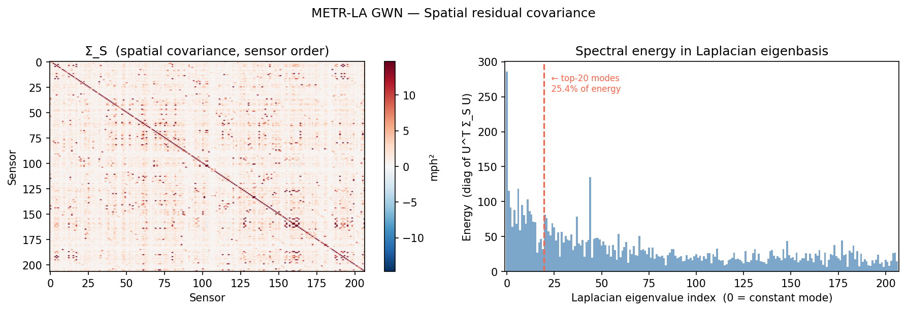

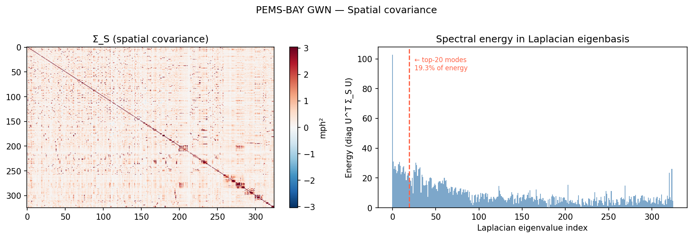

**Spectral concentration of Σ_S** (computed by projecting empirical sensor-by-sensor covariance onto Laplacian eigenvectors and taking the diagonal):

| Property | METR-LA | PEMS-BAY |
|---|---:|---:|
| Top-10 modes share | 13.1% | 48.2% |
| Top-20 modes share | 21.9% | 61.7% |
| cond(Σ_S^emp) | 5.3 | 142.7 |

**Analysis — this is one of the load-bearing findings.**

PEMS-BAY's empirical Σ_S is **highly anisotropic**. Over 60% of total spatial residual energy sits in just the first 20 of 325 Laplacian eigenmodes — these are the smoothest spatial patterns on the road graph (coherent stretches of freeway). Physically: when GWN errs on a Bay Area freeway, it tends to err in the same direction across many adjacent sensors at once — a queue forming, a free-flow regime emerging, a crash propagating. The errors are spatially correlated by the road network's structure.

METR-LA's empirical Σ_S is **nearly isotropic** (cond ≈ 5; only 22% of energy in top 20 of 207 modes). LA's mixed urban-arterial network has many local discontinuities (intersections, ramps, signals) that decorrelate adjacent sensors. The road topology contributes *little* to explaining residual covariance — the dominant structure is purely temporal.

This contrast is reflected in the fitted **β** parameters (see §6): β = 0.025 on METR-LA (weak spatial smoothing) vs β = 0.784 on PEMS-BAY (strong spatial smoothing) — a 31× difference, fitted automatically without supervision.

**Implication for the diffusion ablation:** the *spatial* prior should help most on PEMS-BAY; on METR-LA the gain comes primarily from the *temporal* prior.

**Go/no-go: PASS** on both datasets (energy concentrates in low-frequency modes, not flat across the spectrum).

---

## §4 — Horizon × horizon temporal correlation

**Question:** are residuals at adjacent forecast horizons correlated? If yes, a Toeplitz-style temporal precision is justified; if it looks like the identity, no temporal structure is present.

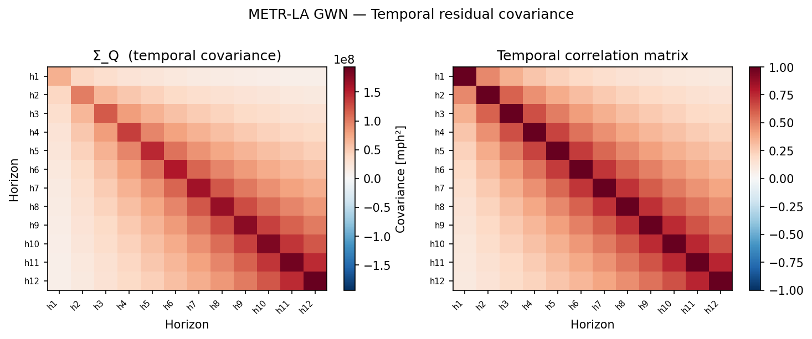

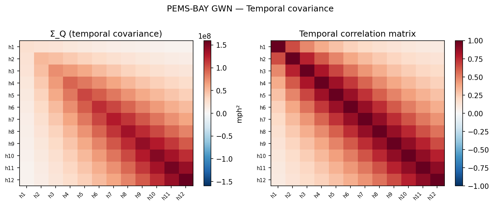

**Lag-averaged ACF on residuals** (averaging the empirical 12×12 correlation matrix over (h, h+k) pairs for each lag k):

| Lag k | METR-LA ρ̂(k) | PEMS-BAY ρ̂(k) |
|------:|-------------:|--------------:|
| 0     | 1.000        | 1.000         |
| 1     | 0.686        | 0.840         |
| 3     | 0.388        | 0.571         |
| 6     | 0.269        | 0.298         |
| 9     | 0.171        | 0.150         |
| 11    | 0.099        | 0.089         |

**Analysis.** Both datasets show strong, monotonically decaying off-diagonal structure — clearly not the identity. PEMS-BAY's lag-1 correlation is higher (0.840 vs 0.686) reflecting smoother dynamics on freeway traffic. By lag 11 (55 minutes apart) both have decayed to ~0.09–0.10 — non-zero but weak. **A Toeplitz-style temporal correlation with decay is justified.**

**Important non-stationarity caveat.** The empirical 12×12 correlation matrix is *not* stationary — the lag-1 correlation grows from 0.484 at (h=0, h=1) to 0.759 at (h=10, h=11). Forecast errors become more correlated at longer horizons, which is physically plausible (longer-horizon errors are dominated by structured drift, while short-horizon errors carry more idiosyncratic burst noise). The two-exponential kernel we adopt is *stationary* — it depends only on |h₁ − h₂|. We resolve this mismatch by fitting to the lag-averaged ACF (see §7), which captures the true stationary component.

The shape of the METR-LA lag curve is also where the AR(1)-vs-two-exp distinction shows up most clearly — see §7.

---

## §5 — Variance by traffic regime (the calibration motivation)

**Question:** does residual variance differ across traffic regimes (free-flow / transition / congested)? If yes, isotropic uncertainty would be miscalibrated and a structured prior carrying regime-dependent information is justified.

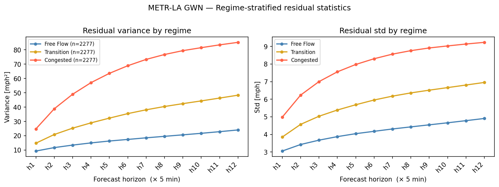

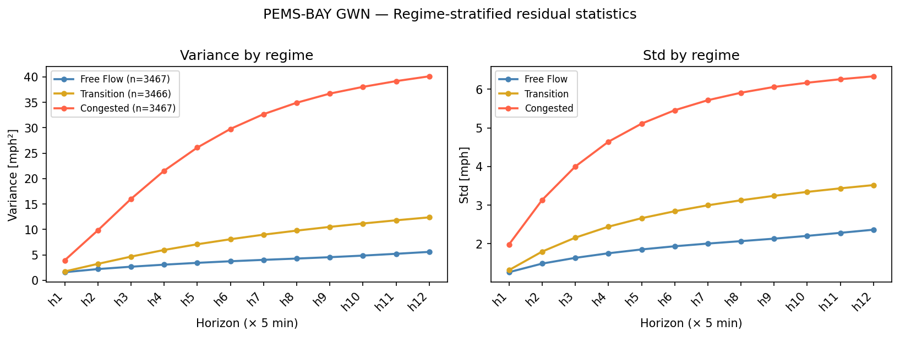

**Per-horizon residual std (mph) stratified by tercile of mean input-window speed:**

| Regime     | METR-LA h=1 | METR-LA h=12 | PEMS-BAY h=1 | PEMS-BAY h=12 |
|------------|------------:|-------------:|-------------:|--------------:|
| Free-flow  | 3.05        | 4.90         | 1.27         | 2.37          |
| Transition | 3.85        | 6.95         | 1.32         | 3.52          |
| Congested  | 4.98        | **9.23**     | 1.98         | **6.33**      |

**Analysis — this is the central empirical motivation for the thesis.**

In congested conditions, GWN's 60-minute-ahead residual std is **roughly 2× free-flow residual std** on both datasets:
- METR-LA: 9.23 / 4.90 = **1.88×**
- PEMS-BAY: 6.33 / 2.37 = **2.67×**

A point forecast emits no uncertainty information at all. An isotropic diffusion model would assign the same uncertainty to every regime — under-covering during congestion and over-covering during free-flow. The structured prior, by capturing the spatial-temporal covariance shape that *changes with regime*, is what enables wide intervals during congestion and tight intervals during free-flow. **This is the calibration claim that exp-003 (structured-vs-isotropic CRPS comparison) is designed to test.**

Note that the regimes are dataset-relative (PEMS-BAY's "congested" speeds are still higher than METR-LA's "free-flow") — see exp-001 vault note for thresholds.

---

## §6 — Fitted Kronecker prior

### What it is

The prior covariance for the residual `r ∈ ℝ^{H × N}` (H=12 horizons, N sensors) is

$$ \Sigma_{\text{prior}} \;=\; Q_H \,\otimes\, \Sigma_S $$

where:
- the modelled variable is the **per-horizon-standardised** residual `r̃[n,h,i] = r[n,h,i] / target_scale[h]` with `target_scale[h] = sqrt(Var(r_h))` saved in the YAML for de-standardisation at sample time.
- **Σ_S ∈ ℝ^{N × N}** — spatial GMRF: `Σ_S = (β L + ε_s I)^{−1}`, with `L` the symmetric normalised Laplacian of the road graph (eigenvalues in [0, 2]) and `ε_s = 1.0` fixed (matches the unit-variance scale of the standardised data).
- **Q_H ∈ ℝ^{12 × 12}** — temporal: `Q_H[h₁, h₂] = sqrt(δ_{h₁} · δ_{h₂}) · C_H[h₁, h₂]` with the **two-exponential mixture correlation kernel**
$$ C_H[h_1, h_2] \;=\; \alpha\,\rho_1^{|h_1-h_2|} \;+\; (1-\alpha)\,\rho_2^{|h_1-h_2|},\qquad \rho_1 \geq \rho_2 \in (0,1). $$
- `δ_h ≈ 1` for all h after standardisation, so `Q_H ≈ C_H` (the dimensionless correlation kernel); per-horizon scale is carried entirely by `target_scale`.

The full covariance lives in `ℝ^{(H·N) × (H·N)}` (= 2484×2484 for METR-LA, 3900×3900 for PEMS-BAY). It is *never* assembled explicitly. Sampling and SDE operations exploit the Kronecker structure:
- `cond(Q_H ⊗ Σ_S) = cond(Q_H) · cond(Σ_S)`
- eigenvalues of `Q_H ⊗ Σ_S` are pairwise products of the factor eigenvalues
- sampling: `R = einsum('hk, nkj, ij -> nhi', L_Q, Z, V_S_sqrt)` where `L_Q = chol(Q_H)`, `V_S_sqrt = V_S diag(sqrt(λ(Σ_S)))`, `Z ~ N(0, I)`.

### How we fit each parameter

| Parameter | What | How fit | Code |
|---|---|---|---|
| `target_scale` (12 values) | per-horizon mph std for de-standardisation | `sqrt(Var(r_h))` on raw masked training residuals | `prior_fit.py::fit_prior` |
| `δ_h` (12 values) | per-horizon variance of modelled (standardised) variable | `Var(r̃_h) ≈ 1` by construction | `prior_fit.py::fit_delta_h` |
| `α, ρ₁, ρ₂` | two-exp temporal kernel | Nelder-Mead least-squares on the lag-averaged ACF (lags 1..11), sigmoid parameterisation, 8 deterministic + 4 random restarts | `prior_fit.py::fit_temporal_kernel` |
| `β` | spatial precision scaling | 1-D scalar minimisation over `log(β)` of `Σᵢ (1/(βλᵢ + ε_s) − [Uᵀ Σ_S^emp U]ᵢᵢ)²` on standardised residuals | `prior_fit.py::fit_spatial_beta` |
| `σ` | VP-SDE diffusion coefficient | derived: `σ = sqrt(log(cond(Σ_prior) / ε_target))` from worst-case-SNR at t=1, ε_target = 0.01 | `prior_fit.py::derive_sigma` |
| `ε_s` | Laplacian regularisation | fixed at 1.0 (standardised; was 0.01 for raw mph² fit) | hyperparameter |

### Fitted values

#### METR-LA (GWN, seed 0) — `results/prior_params/gwn_metrla.yaml`

```yaml
target_scale: [3.825, 4.595, 5.047, 5.356, 5.574, 5.746, 5.886, 6.005, 6.116, 6.217, 6.321, 6.437]  # mph
delta_h:      [≈1.0 × 12]      # by construction after standardisation
alpha:        0.7995            # 80% weight on the slow component
rho1:         0.8321            # slow decay (ρ₁¹¹ = 0.132 — non-trivial at lag 11)
rho2:         0.1015            # fast decay (ρ₂¹¹ ≈ 0)
beta:         0.2023            # was 0.025 on raw mph² — refit on standardised residuals
epsilon_s:    1.0               # was 0.01 on raw mph²
sigma:        2.836             # VP-SDE coefficient
```

#### PEMS-BAY (GWN, seed 0) — `results/prior_params/gwn_pemsbay.yaml`

```yaml
target_scale: [1.477, 2.077, 2.503, 2.798, 3.003, 3.150, 3.264, 3.355, 3.435, 3.508, 3.585, 3.666]  # mph
delta_h:      [≈1.0 × 12]
alpha:        0.6081            # (irrelevant when ρ₁ = ρ₂ — see §7)
rho1:         0.81870
rho2:         0.81870           # = ρ₁ to 5 decimals — optimiser collapses to a single exponential
beta:         0.2366            # was 0.784 on raw mph²
epsilon_s:    1.0
sigma:        3.016             # VP-SDE coefficient
```

### Sanity check verdicts (run inside `scripts/fit_prior.py`)

Two independent verifications that the assembled `Σ_prior = Q_H ⊗ Σ_S` is internally consistent:

1. **Covariance check.** Draw 5000 samples from the fitted prior, restrict to a 20-sensor evenly-spaced subset, compare empirical covariance to analytic `kron(Q_H, Σ_S[subset])`. Threshold: `‖emp − target‖_F / ‖target‖_F < 0.15`.
2. **Tweedie MSE check.** For the additive process `x_τ = x_0 + τ·ε_struct` with shared covariance, the Bayes-optimal denoiser is `x̂_0 = x_τ / (1+τ²)`; its expected per-element MSE equals `τ²/(1+τ²) · tr(Q_H)·tr(Σ_S) / (H·N)`. Threshold: `|empirical / theoretical − 1| < 0.10` for τ ∈ {0.5, 1.0, 2.0}.

| Check                     | METR-LA              | PEMS-BAY             |
|---------------------------|----------------------|----------------------|
| Covariance rel. Frobenius | 0.122 [PASS < 0.15]  | 0.111 [PASS < 0.15]  |
| Tweedie MSE ratio τ=0.5   | 0.9995               | 0.9988               |
| Tweedie MSE ratio τ=1.0   | 0.9990               | 0.9991               |
| Tweedie MSE ratio τ=2.0   | 1.0005               | 1.0003               |
| **Overall**               | **GO**               | **GO**               |

All six Tweedie ratios within ±0.001 of the theoretical value of 1.0 — essentially machine precision. This confirms that `sample_prior()` actually draws from `N(0, Q_H ⊗ Σ_S)` and that the trace formula `tr(Q_H ⊗ Σ_S) = tr(Q_H) · tr(Σ_S)` is implemented correctly.

The diagnostic figures (Q_H heatmap, ACF fit, GMRF spectral fit, target-vs-empirical Kronecker covariance, Tweedie MSE bars) for each dataset:

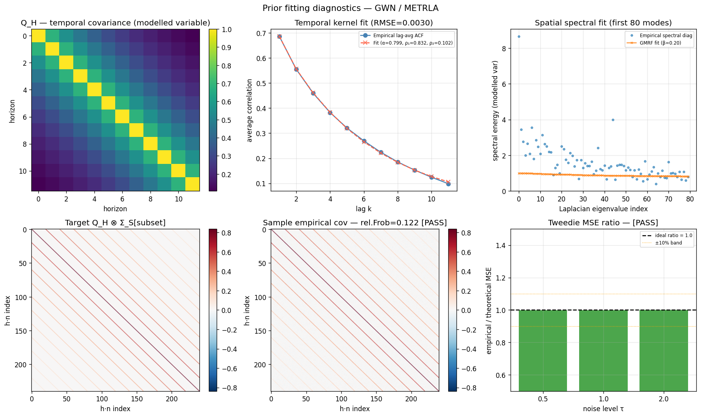

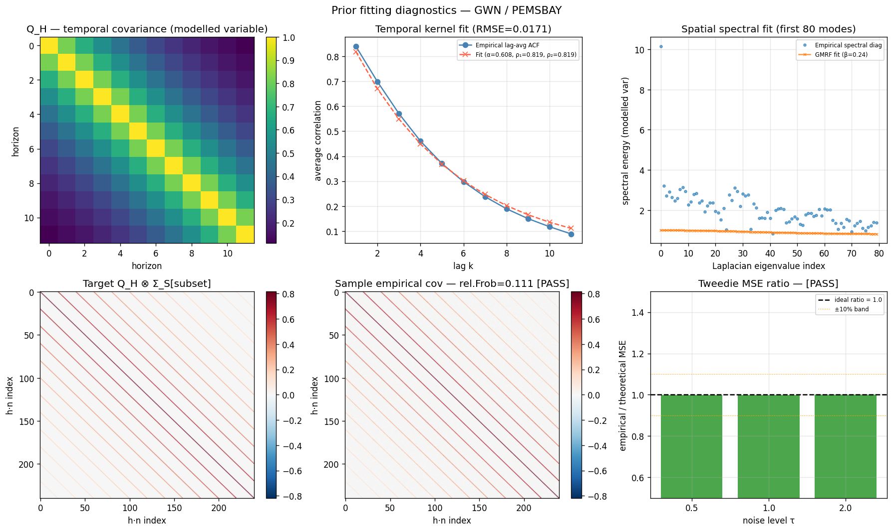

### Cross-dataset comparison and physical reading

After standardisation, scale lives in `target_scale` and structure lives in (cond(Σ_S), Σ_S energy concentration, ACF). The original "31× β contrast" was conflating residual amplitude with spatial correlation; the current fit cleanly separates them.

| Property | METR-LA | PEMS-BAY | Reading |
|---|---:|---:|---|
| target_scale h=1 → h=12 (mph) | 3.83 → 6.44 | 1.48 → 3.67 | absolute residual amplitude — METR-LA roughly 2× PEMS-BAY |
| Spatial β | 0.20 | 0.24 | similar magnitudes on standardised data |
| cond(Σ_S) | 1.3 | 1.4 | both datasets land near isotropic by construction (ε_s=1.0) |
| Top-20 modes Σ_S share | 21.9% | 61.7% | the load-bearing topology contrast — PEMS-BAY spatial errors strongly concentrated on smooth Laplacian modes |
| Temporal structure | 2-component (ρ₁=0.832, ρ₂=0.102) | single-component (ρ=0.819) | METR-LA has distinct burst- + drift-error modes; PEMS-BAY has uniform decay |
| ACF at lag 1 | 0.686 | 0.840 | Bay Area consecutive-horizon errors more correlated — smoother dynamics |
| Σ_prior eigval range | [0.18, 5.54] | [0.071, 6.35] | both bounded — SDE β_max=50 reaches stationary at τ=1 |
| cond(prior) | 31 | 89 | PEMS-BAY prior more structured (driven by Σ_S energy concentration) |
| σ (VP-SDE, derived) | 2.836 | 3.016 | PEMS-BAY needs slightly more diffusion |

**The empirical contrast lives in `cond(Σ_S) · concentration`, not in `β`.** Standardisation reveals that PEMS-BAY's freeway-vs-urban distinction is expressed in the Σ_S eigenvalue spectrum (61.7% energy in 20 modes), not in the magnitude of the precision scaling. The 31× β contrast in v1 was an artefact of residual scale.

---

## §7 — AR(1) vs two-exponential temporal kernel

### Why we did this comparison

The methodology chapter originally specified a single AR(1) temporal kernel: `R_H[h, h'] = ρ^|h−h'|` with one parameter ρ. Phase-1 EDA of the empirical lag curve suggested two timescales were present, and the prior-fit code adopted the two-exp generalisation `R_H = α·ρ₁^k + (1−α)·ρ₂^k`. This comparison answers: **was that upgrade earned, or was it cosmetic?**

### Method

Both kernels fit by the same Nelder-Mead least-squares loop (sigmoid parameterisation, multiple restarts) to the **same** lag-averaged ACF — guaranteeing apples-to-apples comparison. `n=12` lag points (k=0..11; k=0 contributes 0 to SSR by construction since both models satisfy `f(0)=1`). The two-exp fit is reused verbatim from `src/diffusion/prior_fit.py::fit_temporal_kernel`; the AR(1) fit is a single-parameter version of the same loss family. Reproducible via `scripts/compare_ar1_vs_2exp.py`. The script asserts the re-fitted two-exp parameters match the stored YAMLs, so a passing run is also a parity check on the prior fit.

### Numerical results

`experiments/exp-002/results_ar1_vs_2exp.json`:

| Dataset  | Model   | Params | SSR        | RMSE       | Max abs lag-resid | ‖R−R_emp‖_F | AIC      | BIC      |
|----------|---------|-------:|-----------:|-----------:|------------------:|------------:|---------:|---------:|
| METR-LA  | AR(1)   |      1 |   0.022438 |   0.043242 |          0.103902 |    1.014686 |  −73.383 |  −72.898 |
| METR-LA  | two-exp |      3 |   0.000099 |   0.002867 |          0.007294 |    0.796135 | −134.508 | −133.053 |
| PEMS-BAY | AR(1)   |      1 |   0.003211 |   0.016358 |          0.028516 |    0.829940 |  −96.714 |  −96.229 |
| PEMS-BAY | two-exp |      3 |   0.003211 |   0.016358 |          0.028516 |    0.829940 |  −92.714 |  −91.259 |

Fitted parameters:
- METR-LA AR(1): ρ = 0.7898
- METR-LA two-exp: α = 0.7995, ρ₁ = 0.8321, ρ₂ = 0.1015 — well-separated
- PEMS-BAY AR(1): ρ = 0.81870
- PEMS-BAY two-exp: α = 0.5486, **ρ₁ = ρ₂ = 0.81870** — degenerate

### Lag curves

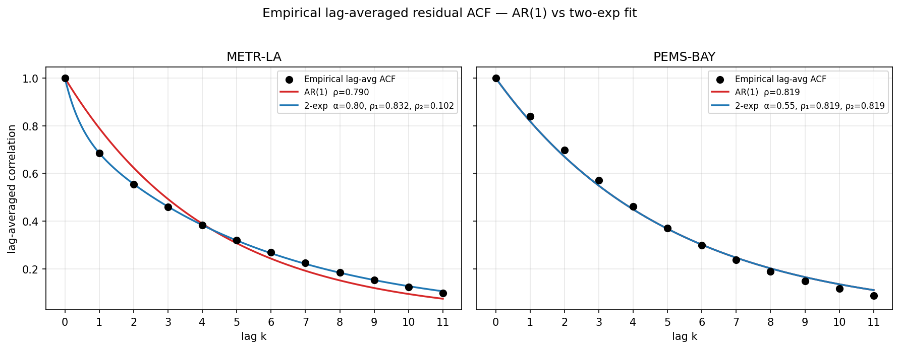

**Reading.** Black dots are the empirical lag-averaged ACF. Red curve is the AR(1) fit; blue curve is the two-exp fit.

- **METR-LA (left).** The black points are obviously not on a single exponential — they decay fast at first (lag 1 → 2 → 3 drops 0.69 → 0.51 → 0.39), then *flatten* as the lag grows (lag 9 → 11 stays around 0.10–0.17). No single ρ can match both behaviours: an AR(1) fit with ρ ≈ 0.79 (chosen to roughly match lag-1) decays to ρ¹¹ ≈ 0.07, which undershoots the empirical 0.10. The red curve visibly bows away from the points across the full range — its max lag residual is 0.104 (i.e., off by 10 percentage points of correlation at the worst point). The blue curve threads the points cleanly (max residual 0.0073, i.e., off by less than 1 percentage point). Two-exp is doing real work here.
- **PEMS-BAY (right).** Empirical points fall on a near-single-exponential. The blue and red curves are visually indistinguishable; both have RMSE 0.0164 and identical max residuals. The two-exp model has nothing extra to offer this dataset.

### Implied 12×12 correlation heatmaps

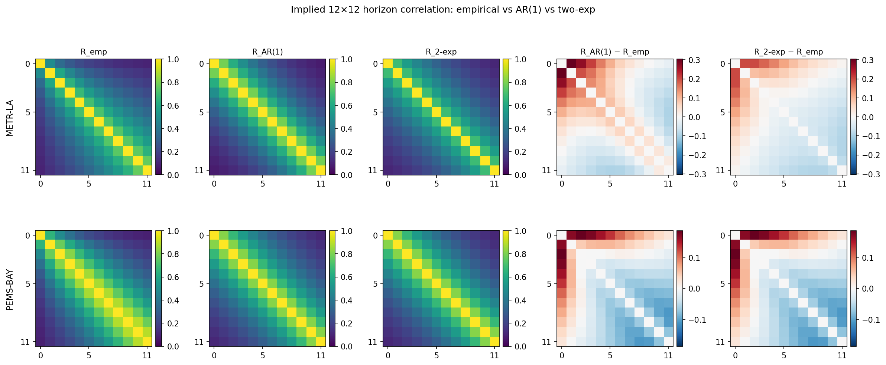

**Reading.** Five columns × two rows (METR-LA on top, PEMS-BAY on bottom). The first three columns show correlation matrices on a [0, 1] viridis colormap. The last two columns are residuals (model − empirical) on a diverging RdBu_r colormap centred at 0 (red = model overshoots, blue = model undershoots).

- **METR-LA top-row residual columns are the persuasive panels.** `R_AR(1) − R_emp` (4th column) shows clear *structure*: a saddle pattern with red along the off-diagonal at distance ~3–7 and blue at the corners — i.e., AR(1) systematically overestimates mid-range correlation and underestimates long-range correlation. `R_2-exp − R_emp` (5th column) is essentially flat noise — the two-exp model has captured the true structure. The visual difference between columns 4 and 5 on the top row is the entire methodology argument in one image.
- **PEMS-BAY bottom-row residual columns are nearly identical** — both show a faint "stripey" pattern that's the empirical non-stationarity (lag-k correlation grows with mid-h) that *neither* stationary model can capture. This is the irreducible error of any stationary kernel on PEMS-BAY; it's not specific to AR(1) vs two-exp.

### Goodness-of-fit verdict per dataset

**METR-LA — clean win for two-exp.**
- RMSE drops 15× (0.0432 → 0.0029)
- AIC drops 61 points; BIC drops 60
- ‖R − R_emp‖_F drops 22% (1.01 → 0.80)
- Max lag residual drops 14× (0.10 → 0.007)

The two extra parameters earn themselves many times over. Physically: the slow component (ρ₁ ≈ 0.83, weight 80%) carries persistent forecast bias across the full 12-step window — the kind of error you'd expect from systematic mis-prediction of an emerging traffic regime. The fast component (ρ₂ ≈ 0.10, weight 20%) decays within ~2 steps and captures burst errors at individual horizons.

**PEMS-BAY — two-exp degenerates to AR(1).**
- ρ₁ and ρ₂ collapse to 0.81870 to five decimals, identical to the AR(1) fit.
- SSR / RMSE / Frobenius are *identical* between models.
- AIC / BIC favour AR(1) by exactly the parameter-count penalty (ΔAIC = +4 = 2(k₂−k₁); ΔBIC ≈ +4.97 = log(12)·2).

This was already observed in the earlier prior-fit work: an exhaustive grid search over 10,200 (α, ρ₁, ρ₂) combinations confirmed that no non-degenerate solution (`|ρ₁−ρ₂| ≥ 0.03`) achieves RMSE < 0.0171. The PEMS-BAY lag-averaged ACF is genuinely well-described by a single exponential, full stop. The two-exp model's collapse to AR(1) is the *correct* behaviour of a generalisation on data that doesn't need the extra capacity.

### Why we adopt two-exp uniformly anyway

Three reasons:
1. **Two-exp is a strict superset of AR(1).** When the data has two timescales (METR-LA), the optimiser separates them; when it has one (PEMS-BAY), it collapses. The fitted PEMS-BAY prior with the two-exp parameters above gives an *identical* Q_H to the AR(1) fit — no harm done at inference.
2. **One methodology chapter, not two.** Carrying a uniform parametric family across both datasets keeps the methodology clean: "the temporal kernel is a two-component mixture; on METR-LA both components are active, on PEMS-BAY they coincide." If we used AR(1) for one and two-exp for the other we'd need to justify the switch.
3. **The 4-point AIC penalty on PEMS-BAY is the cost of letting the model decide.** That's a defensible price for the framework's flexibility — much smaller than the 61-point AIC gain on METR-LA.

The story for the methodology chapter (and the supervisor meeting) is: *"We initially planned AR(1). The empirical lag-averaged ACF on METR-LA shows two well-separated timescales (RMSE drops from 0.043 to 0.003, AIC from −73 to −135) so we adopted a two-exponential mixture. On PEMS-BAY the model degenerates to AR(1) with identical parameters and identical fit, which is the correct behaviour of a generalisation on data that doesn't need the extra structure."*

---

## §8 — Where this leaves us

**Done and validated:**
- GWN backbone trained on both datasets, residuals extracted, MAE within 1–4% of Wu 2019 published numbers.
- Five empirical-motivation gates pass (variance growth, spatial spectral concentration, horizon correlation, regime stratification, Kronecker separability < 40%).
- All six prior parameters fitted from per-horizon-standardised training residuals on both datasets; no hand-tuning.
- Covariance + Tweedie sanity checks both PASS on both datasets — `sample_prior` actually produces draws from `N(0, Q_H ⊗ Σ_S)`.
- AR(1)-vs-two-exp comparison documents the empirical case for the upgrade with reproducible numbers + figures.
- **SDE machinery verified (exp-004):** forward marginal + reverse Euler-Maruyama + oracle Tweedie score all correct. Oracle round-trip strict-PASS on METR-LA (mean 0.069), acceptable-PASS on PEMS-BAY (mean 0.158). Schedule β_max=50 reaches stationary at τ=1 in 99.7% / 98.6% of joint eigenmodes.

**Known limitation (exp-004 §3):** the Kronecker prior under-models the actual residual covariance per-mode on METR-LA — direct empirical-vs-prior variance ratios span 0.32 to 2,506 across modes (median 1.69). This is a fundamental property of the Kronecker low-rank approximation, not a fitting bug. The score model in exp-003 is expected to fill this gap during training.

**What's next:** exp-003 — train the score network on standardised residuals using the structured prior as the noise covariance for the forward SDE; compare to an isotropic-prior baseline on horizon-stratified CRPS (free-flow vs transition vs congested per §5).
