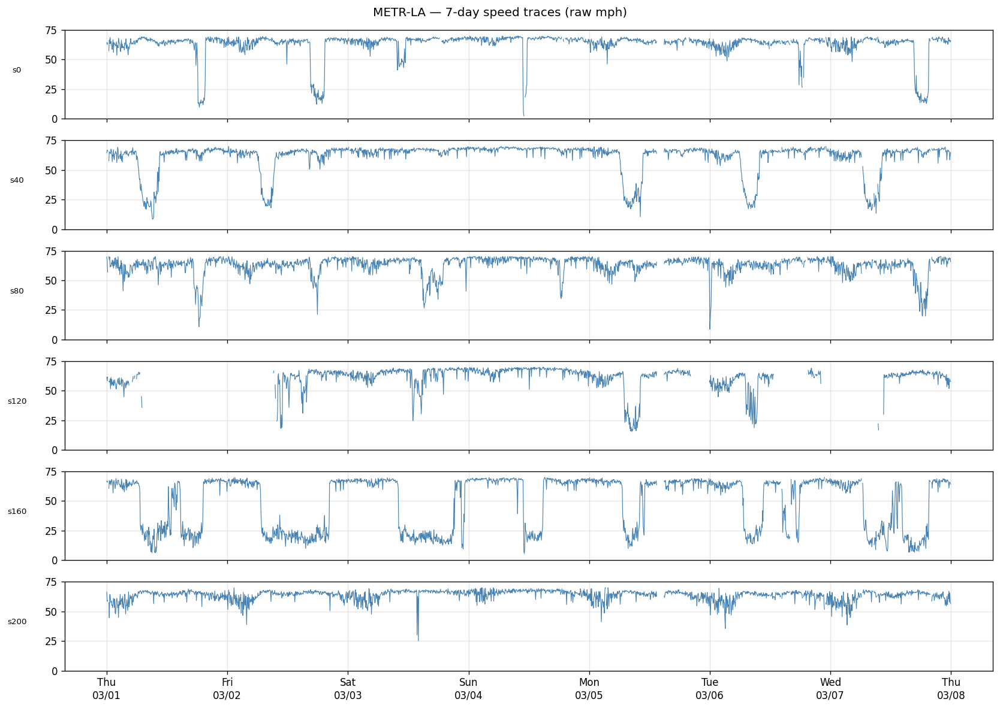
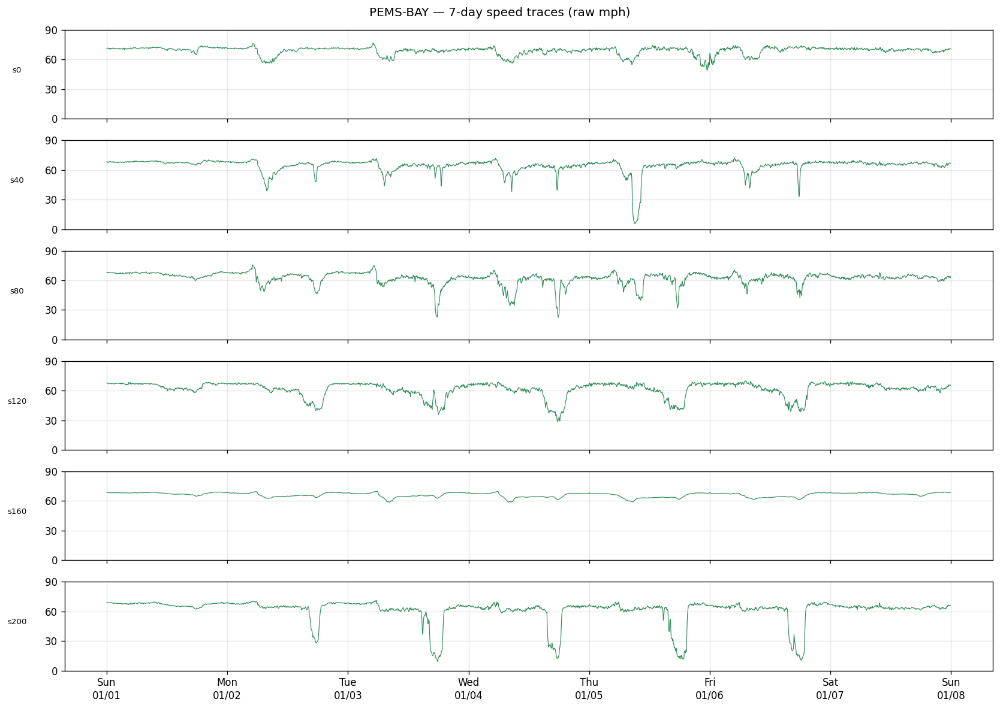
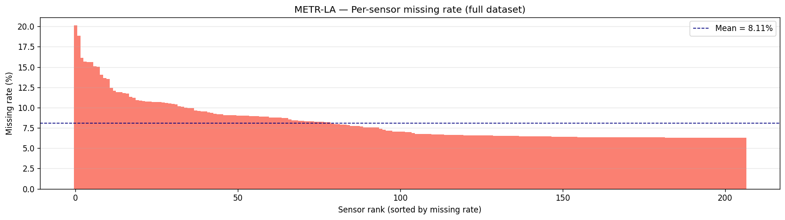
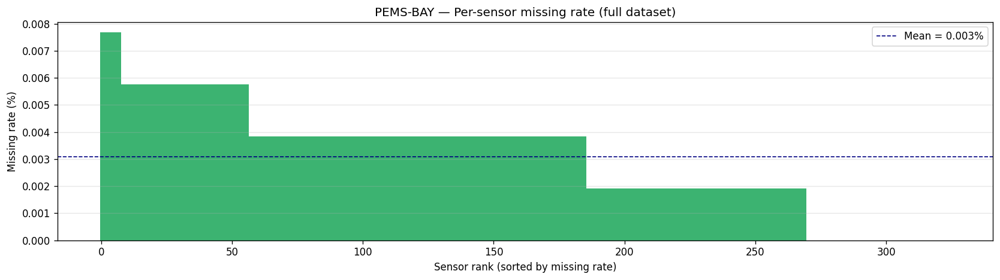
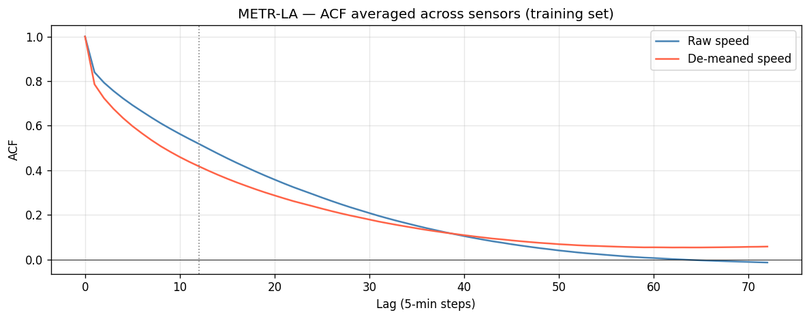
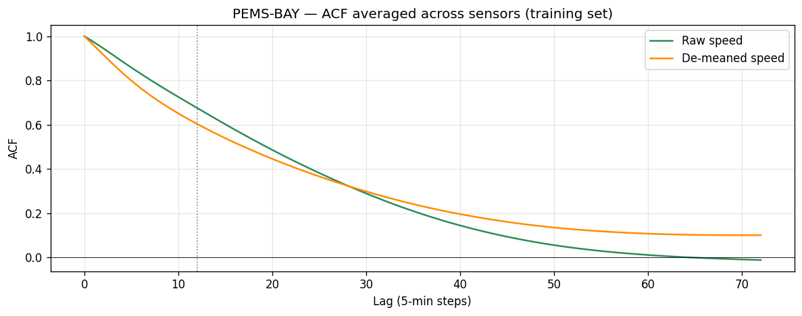
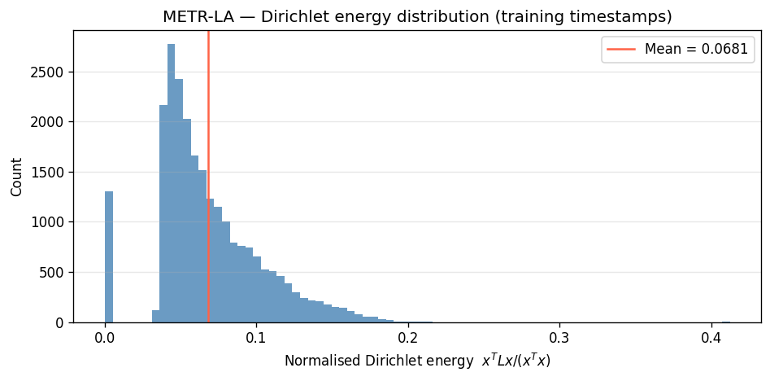
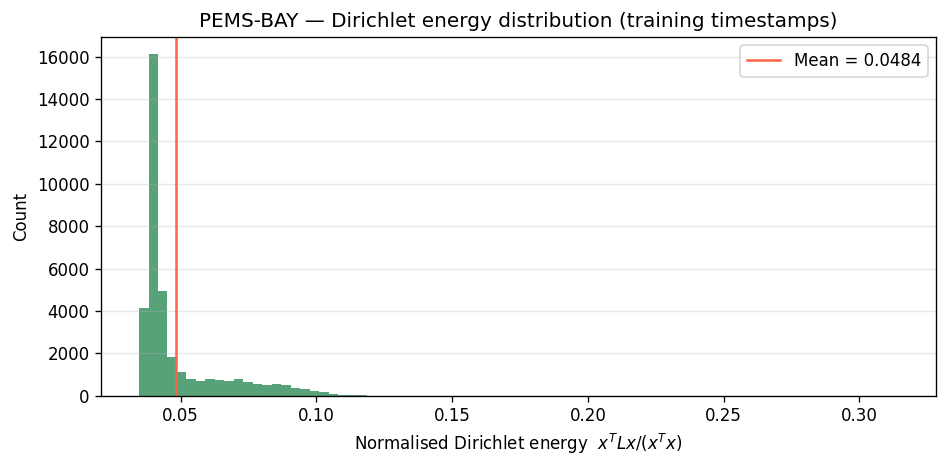
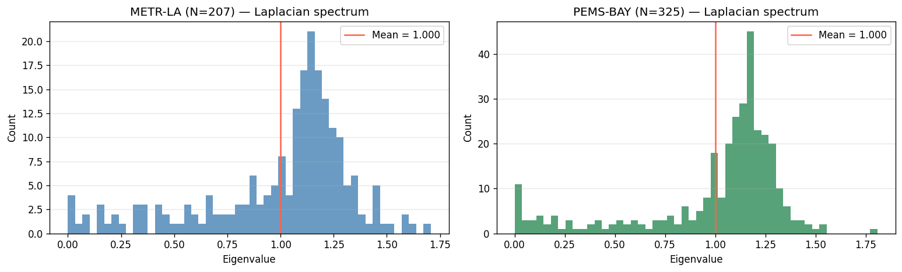

# Data & residuals — overview

A one-page snapshot of what the input datasets look like, what the masked residuals from the trained GWN backbone look like, and where to find each artifact. For analytical depth on the residual *structure* (variance vs horizon, spatial covariance, horizon correlation, regime stratification) see [[exp-001-residual-diagnostics/SUMMARY]]. For the model that produced the residuals see [[backbone-training/SUMMARY]].

---

## §1 — The two datasets

| Property | METR-LA | PEMS-BAY |
|---|---|---|
| Sensors (N) | 207 | 325 |
| Total timestamps (T) | 34,272 | 52,116 |
| Date range | Mar–Jun 2012 | Jan–Jun 2017 |
| Resolution | 5 min | 5 min |
| Train / val / test windows (12-step in / 12-step out, stride 1) | 23,967 / 3,405 / 6,831 | 36,458 / 5,189 / 10,400 |
| Speed mean (training, raw mph) | 54.41 | 62.73 |
| Speed std (training, raw mph) | 19.49 (CV ≈ 36%) | 9.44 (CV ≈ 15%) |
| Mean missing rate | 8.11% | 0.003% |
| Max missing rate (any sensor) | 20.1% (sensor 105) | 0% |
| Sensors > 10% missing | 34 of 207 | 0 of 325 |
| Mean Dirichlet energy `xᵀLx / xᵀx` | 0.0681 | 0.0484 |
| Normalised Laplacian eigenvalue range | [0, 1.7062] | [0, 1.8083] |

**Reading.**
- **PEMS-BAY is a larger dataset** (57% more sensors, 52% more timestamps) covering a more uniform freeway network. **METR-LA is smaller and noisier**, with a denser urban+arterial mix.
- **Speed distributions differ substantially.** METR-LA (LA freeway+urban) has lower mean and much higher variability (CV 36%). PEMS-BAY (Bay Area freeway) is faster and tighter (CV 15%). Implication: residual scales are *not* directly comparable across datasets.
- **METR-LA has significant non-uniform missing data** (8% mean, with 34 sensors above 10%). The masked-MAE loss is load-bearing here. PEMS-BAY is effectively complete (0.003%) — masking is a no-op for it.
- **Both datasets are spatially smooth on the road graph.** Mean Dirichlet energy < 0.07 ≪ 1 on both. PEMS-BAY (0.048) is smoother than METR-LA (0.068), consistent with its almost-exclusively-freeway network: adjacent freeway sensors share traffic state more uniformly than urban sensors do. This is the empirical premise of the graph-Laplacian spatial prior.
- **Both Laplacian spectra are PSD** (λ_min = 0). The symmetrise + strip-self-loops fix is necessary because the raw adjacency files are directed and have unit self-loops; without it, the "Laplacian" has 13 negative eigenvalues. After the fix, eigenvalues are correctly bounded in [0, 2].

---

## §2 — Weekly cycles (raw speed)





Both datasets show clear diurnal structure (morning + evening rush), and clear weekday/weekend distinction. METR-LA shows higher within-day variability per sensor; PEMS-BAY shows tight, repeatable patterns.

This dominant cyclic signal is what the GWN backbone learns to predict. The *residuals* (what's left over after subtracting GWN's forecast) are the irreducible forecast error that the diffusion prior models — see §6 below.

---

## §3 — Missingness





METR-LA's missing pattern is **non-random**: certain sensors drop together along the same corridor, suggesting infrastructure-level failures rather than independent measurement noise. PEMS-BAY is effectively complete.

The mask convention is `mask = (raw_speed != 0.0)`, computed *before* normalisation — zeros are meaningful (= missing) only on the raw scale; after z-scoring they become non-zero and the mask information would be lost.

---

## §4 — Temporal autocorrelation of speed (not residuals)





**Raw speed ACF**: both datasets show strong, slowly-decaying autocorrelation (ACF > 0.8 at lag 12, > 0.5 at lag 72). This reflects the dominant diurnal cycle (rush hours recur daily). It's not a useful proxy for residual structure because the backbone is trained to predict the diurnal mean.

**De-meaned ACF** (after subtracting per-sensor per-time-of-day mean): decays much faster. At lag 12 (60 min, the full prediction horizon), the de-meaned ACF is ~0.3–0.4 on METR-LA and ~0.2–0.3 on PEMS-BAY. This is the proxy for what residual structure should look like, and it's what motivates a low-order temporal model (initially AR(1), upgraded to two-exponential mixture; see [[exp-002-q-construction/SUMMARY|exp-002]]).

---

## §5 — Spatial smoothness and Laplacian spectrum







Both Dirichlet-energy distributions are right-skewed, with mass near zero (smooth conditions where all sensors share a state, e.g., congestion) and a long tail (mixed conditions where speeds vary across the network).

**The Laplacian spectrum** is the basis for the GMRF prior `Σ_S = (β L + ε_s I)^{−1}`. PEMS-BAY's slightly wider spectrum (λ_max = 1.808 vs 1.706) reflects a few high-degree freeway interchange sensors. The fitted β values reflect dataset character: METR-LA β = 0.025 (weak smoothing); PEMS-BAY β = 0.784 (strong smoothing) — a 31× contrast that emerges from the residuals alone.

---

## §6 — Residual scale and bias (GWN training residuals)

This is the input to all downstream prior work. Residuals are computed as `r = y_true − y_pred` in **raw mph** (the model's normalised output is inverse-transformed before subtracting), with the validity mask preserved.

| | METR-LA | PEMS-BAY |
|---|---:|---:|
| Global mean residual (mph) | −0.66 | −0.13 |
| h=1 std (mph) | 3.82 | 1.48 |
| h=3 std (mph) | 5.05 | 2.50 |
| h=6 std (mph) | 5.75 | 3.15 |
| h=12 std (mph) | 6.44 | 3.67 |
| Growth h=12 / h=1 | 1.69× | 2.48× |
| Missing fraction (train) | ~7% | ~0% |

**Reading.**
- Backbone is approximately **unbiased** on both datasets (a small −0.66 mph bias on METR-LA — GWN slightly over-predicts speed — is worth a thesis footnote but does not affect the prior fit).
- Residual std grows monotonically with horizon on both datasets — confirms that uncertainty grows with prediction time, justifying horizon-dependent variance scaling `δ_h` in `Q_H`.
- **METR-LA residuals are roughly 2× larger than PEMS-BAY residuals at every horizon**, consistent with LA's mixed urban-arterial network being noisier than Bay Area freeway traffic.
- The h=12 / h=1 growth ratio is steeper on PEMS-BAY (2.48×) than on METR-LA (1.69×) in *relative* terms — likely because PEMS-BAY's baseline residual at h=1 is very small (~2.5% of mean speed) so any longer-horizon error compounds harder in proportional terms.

For the full structural analysis (sensor×sensor covariance, horizon×horizon correlation, regime stratification, Kronecker separability) see [[exp-001-residual-diagnostics/SUMMARY|exp-001]].

---

## §7 — Where things live

| Artifact | Path |
|---|---|
| Raw .h5 files (gitignored) | `data/raw/{metr-la,pems-bay}.h5` |
| Adjacency pkls (gitignored) | `data/raw/adj_mx_{metrla,pemsbay}.pkl` |
| Preprocessed train/val/test arrays (gitignored) | `data/processed/{dataset}_{split}.npz` |
| Preprocessed scaler (mean, std for the speed channel) | `data/processed/{dataset}_scaler.yaml` |
| Cached normalised-Laplacian eigendecomposition | `data/processed/{dataset}_laplacian_eigs.npz` |
| Test-set regime labels (free-flow / transition / congested) | `data/processed/{dataset}_regimes_test.npz` |
| GWN checkpoints (gitignored) | `results/checkpoints/gwn_{dataset}_seed0_*/best.pt` |
| Residuals (raw mph, masked) | `results/residuals/gwn_{dataset}_{split}_seed0.npz` |
| Fitted prior parameters | `results/prior_params/gwn_{dataset}.yaml` |
| EDA figures | `experiments/eda/figures/` |
| Diagnostic figures | `experiments/exp-001-residual-diagnostics/figures/` |
| Prior-check figures | `experiments/exp-002-q-construction/figures/` |
| Backbone metrics (MAE/RMSE/MAPE per horizon, val + test) | `experiments/backbone-training/metrics.json` |

## Reproduction

```bash
bash scripts/download_data.sh                              # raw data
python scripts/preprocess.py --dataset metrla              # build sliding windows + scaler
python scripts/preprocess.py --dataset pemsbay
python scripts/diagnose_temporal_acf.py                    # produces the EDA ACF figures
# Backbone training, residual extraction, prior fit — see backbone-training/SUMMARY.md
#                                                       and exp-002-q-construction/SUMMARY.md
```

The interactive notebook `notebooks/01_data_eda.ipynb` produced the original EDA figures shown above; the figures are now in `experiments/eda/figures/` rather than the path the notebook references (`results/figures/eda/`). The notebook is left unchanged for archival purposes — re-running it would recreate the figures in the old location.
