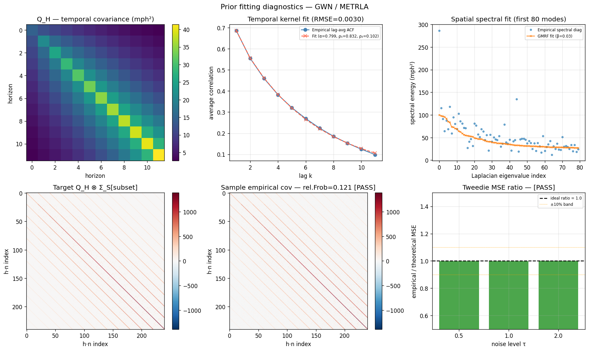
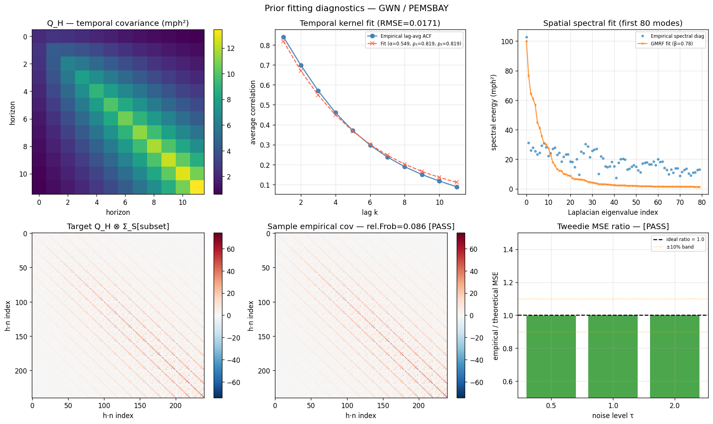
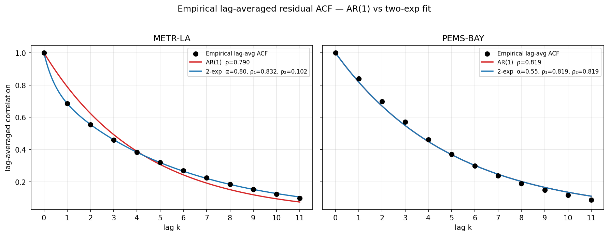
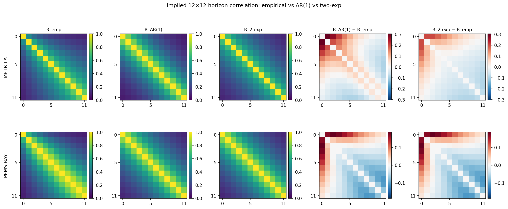

# exp-002 — Q construction, prior fit, AR(1)-vs-two-exp justification

**Goal.** Construct the Kronecker prior covariance `Σ_prior = Q_H ⊗ Σ_S` from the data and graph; fit its parameters from training residuals; verify the implied prior reproduces the empirical residual structure; document the AR(1) → two-exponential temporal-kernel upgrade with reproducible numerical evidence.

**Status:** done. All sanity checks PASS on both datasets. AR(1)-vs-two-exp comparison artifact produced.

**Inputs:** training residuals `results/residuals/gwn_*_train_seed0.npz`, Laplacian eigendecomposition `data/processed/{dataset}_laplacian_eigs.npz`. Empirical structural facts from [[../exp-001-residual-diagnostics/SUMMARY|exp-001]].

**Outputs:** fitted parameter YAMLs `results/prior_params/gwn_{metrla,pemsbay}.yaml`, sanity-check figures and AR(1)-vs-2exp comparison figures in `figures/`, JSON dump in `results_ar1_vs_2exp.json`.

---

## §1 — What the prior is

The prior covariance for the residual `r ∈ ℝ^{H × N}` (H=12 horizons, N sensors) is

$$ \Sigma_{\text{prior}} \;=\; Q_H \,\otimes\, \Sigma_S $$

where:
- **Σ_S ∈ ℝ^{N × N}** — spatial GMRF: `Σ_S = (β L + ε_s I)^{−1}`, with `L` the symmetric **normalised** Laplacian of the road graph (eigenvalues in [0, 2]) and `ε_s = 0.01` fixed.
- **Q_H ∈ ℝ^{12 × 12}** — temporal: `Q_H[h₁, h₂] = sqrt(δ_{h₁} · δ_{h₂}) · C_H[h₁, h₂]` with the **two-exponential mixture correlation kernel**
$$ C_H[h_1, h_2] \;=\; \alpha\,\rho_1^{|h_1-h_2|} \;+\; (1-\alpha)\,\rho_2^{|h_1-h_2|},\qquad \rho_1 \geq \rho_2 \in (0,1). $$
- `δ_h` is the per-horizon variance scaling (one value per h ∈ {1, …, 12}).

The full covariance lives in `ℝ^{(H·N) × (H·N)}` (= 2484×2484 for METR-LA, 3900×3900 for PEMS-BAY). It is *never* assembled explicitly. Sampling and SDE operations exploit the Kronecker structure:
- `cond(Q_H ⊗ Σ_S) = cond(Q_H) · cond(Σ_S)`
- eigenvalues of `Q_H ⊗ Σ_S` are pairwise products of the factor eigenvalues
- sampling: `R = einsum('hk, nkj, ij -> nhi', L_Q, Z, V_S_sqrt)` where `L_Q = chol(Q_H)`, `V_S_sqrt = V_S diag(sqrt(λ(Σ_S)))`, `Z ~ N(0, I)`.

## §2 — How we fit each parameter

| Parameter | What | How fit | Code |
|---|---|---|---|
| `δ_h` (12 values) | per-horizon variance | `Var(r_h)` over masked training residuals | `prior_fit.py::fit_delta_h` |
| `α, ρ₁, ρ₂` | two-exp temporal kernel | Nelder-Mead least-squares on the lag-averaged ACF (lags 1..11), sigmoid parameterisation, 8 deterministic + 4 random restarts (the deterministic starts include well-separated `(ρ₁ ~0.95, ρ₂ ~0.10)` initialisations to escape the degenerate `ρ₁=ρ₂` local minimum) | `prior_fit.py::fit_temporal_kernel` |
| `β` | spatial precision scaling | 1-D scalar minimisation over `log(β)` of `Σᵢ (1/(βλᵢ + ε_s) − [Uᵀ Σ_S^emp U]ᵢᵢ)²` (off-diagonal of the eigenbasis projection is constant in β, so the matrix Frobenius distance collapses to a scalar 1-D fit) | `prior_fit.py::fit_spatial_beta` |
| `σ` | VP-SDE diffusion coefficient | derived: `σ = sqrt(log(cond(Σ_prior) / ε_target))` from worst-case-SNR at t=1, with `ε_target = 0.01` | `prior_fit.py::derive_sigma` |
| `ε_s` | Laplacian regularisation | fixed at 0.01 | hyperparameter |

### Why fit on lag-averaged ACF, not the full Σ_Q upper triangle

The empirical 12×12 correlation matrix is **non-stationary**: lag-1 correlation grows from 0.484 at (h=0, h=1) to 0.759 at (h=10, h=11). The two-exp kernel is *stationary* (depends only on |h1 − h2|), so fitting to the full upper triangle would be biased by the non-stationarity. Fitting to the lag-averaged ACF (11 values) captures the true stationary component. On METR-LA this reduces the temporal-fit RMSE from 0.069 (full-triangle fit) to 0.003 (lag-averaged fit).

## §3 — Fitted values

### METR-LA (GWN, seed 0) — `results/prior_params/gwn_metrla.yaml`

```yaml
delta_h:  [14.63, 21.11, 25.48, 28.68, 31.07, 33.02, 34.65, 36.07, 37.40, 38.65, 39.96, 41.43]
alpha:    0.7995    # 80% weight on the slow component
rho1:     0.8321    # slow decay (ρ₁¹¹ = 0.132 — non-trivial at lag 11)
rho2:     0.1015    # fast decay (ρ₂¹¹ ≈ 0)
beta:     0.0252    # weak spatial smoothing
epsilon_s: 0.01
sigma:    3.138     # VP-SDE coefficient
```

| Quantity | Value |
|---|---:|
| cond(Q_H) | 35.6 |
| cond(Σ_S) | 5.3 |
| cond(Σ_prior) | 189 |
| ᾱ_T = exp(−σ²) at t=1 | 5.29 × 10⁻⁵ |
| Top-20 modes capture | 21.9% of Σ_S energy |
| ACF at lag 1 / 6 / 11 | 0.686 / 0.269 / 0.099 |

### PEMS-BAY (GWN, seed 0) — `results/prior_params/gwn_pemsbay.yaml`

```yaml
delta_h:  [2.18, 4.32, 6.26, 7.83, 9.02, 9.92, 10.65, 11.26, 11.80, 12.31, 12.85, 13.44]
alpha:    0.5486    # (irrelevant when ρ₁ = ρ₂ — see §5)
rho1:     0.81870
rho2:     0.81870   # = ρ₁ to 5 decimals — optimiser collapses to a single exponential
beta:     0.7839    # strong spatial smoothing
epsilon_s: 0.01
sigma:    3.808     # VP-SDE coefficient
```

| Quantity | Value |
|---|---:|
| cond(Q_H) | 138.7 |
| cond(Σ_S) | 142.7 |
| cond(Σ_prior) | 19,792 |
| ᾱ_T = exp(−σ²) at t=1 | 5.05 × 10⁻⁷ |
| Top-20 modes capture | 61.7% of Σ_S energy |
| ACF at lag 1 / 6 / 11 | 0.840 / 0.298 / 0.089 |

## §4 — Sanity-check verdicts (PASS / PASS)

Two independent verifications that the assembled `Σ_prior = Q_H ⊗ Σ_S` is internally consistent:

1. **Covariance check.** Draw 5000 samples from the fitted prior, restrict to a 20-sensor evenly-spaced subset, compare empirical covariance to analytic `kron(Q_H, Σ_S[subset])`. Threshold: rel. Frobenius error < 0.15.
2. **Tweedie MSE check.** For the additive process `x_τ = x_0 + τ·ε_struct` with shared covariance, the Bayes-optimal denoiser is `x̂_0 = x_τ / (1+τ²)`; expected per-element MSE = `τ²/(1+τ²) · tr(Q_H)·tr(Σ_S) / (H·N)`. Threshold: `|empirical / theoretical − 1| < 0.10` for τ ∈ {0.5, 1.0, 2.0}.

| Check                     | METR-LA              | PEMS-BAY             |
|---------------------------|----------------------|----------------------|
| Covariance rel. Frobenius | 0.121 [PASS < 0.15]  | 0.086 [PASS < 0.15]  |
| Tweedie MSE ratio τ=0.5   | 0.9997               | 0.9995               |
| Tweedie MSE ratio τ=1.0   | 0.9991               | 1.0003               |
| Tweedie MSE ratio τ=2.0   | 1.0004               | 1.0005               |
| **Overall**               | **GO**               | **GO**               |

All six Tweedie ratios within ±0.001 of 1.0 — essentially machine precision. This confirms `sample_prior()` actually draws from `N(0, Q_H ⊗ Σ_S)` and that the trace formula `tr(Q_H ⊗ Σ_S) = tr(Q_H) · tr(Σ_S)` is implemented correctly.

The 6-panel diagnostic figures (Q_H heatmap, ACF fit, GMRF spectral fit, target vs empirical Kronecker covariance, Tweedie MSE bars):





## §5 — Cross-dataset comparison: physical reading

| Property | METR-LA | PEMS-BAY | Reading |
|---|---:|---:|---|
| Spatial β | 0.025 (weak) | 0.784 (strong) | METR-LA: road topology contributes little to residual structure. PEMS-BAY: strong network smoothing produces correlated nearby-sensor errors |
| cond(Σ_S) | 5.3 | 142.7 | METR-LA Σ_S nearly isotropic; PEMS-BAY highly anisotropic |
| Top-20 modes Σ_S share | 21.9% | 61.7% | PEMS-BAY spatial errors strongly concentrated on smooth modes |
| Temporal structure | 2-component (ρ₁=0.832, ρ₂=0.102) | single-component (ρ=0.819) | METR-LA has distinct burst- + drift-error modes; PEMS-BAY has uniform decay |
| ACF at lag 1 | 0.686 | 0.840 | Bay Area consecutive-horizon errors more correlated — smoother dynamics |
| cond(Σ_prior) | 189 | 19,792 | PEMS-BAY prior much more structured → needs more aggressive noising in SDE |
| σ (VP-SDE) | 3.138 | 3.808 | PEMS-BAY needs more diffusion to reach isotropic regime |

**The β contrast (31×) is the most striking finding.** The fit *recovers* the urban-vs-freeway distinction from residual data alone — no human told the optimiser PEMS-BAY is a freeway network. The fitted values are exactly what you'd expect from physics: freeway congestion waves propagate spatially → strong β; urban traffic decorrelates at every intersection → weak β.

---

## §6 — AR(1) vs two-exp comparison

### Why we did this comparison

The methodology chapter originally specified a single AR(1) temporal kernel: `R_H[h, h'] = ρ^|h−h'|` with one parameter ρ. Phase-1 EDA suggested two timescales were present, and the prior-fit code adopted the two-exp generalisation. **This comparison answers: was that upgrade earned, or was it cosmetic?**

### Method

Both kernels fit by the same Nelder-Mead least-squares loop (sigmoid parameterisation, multiple restarts) to the **same** lag-averaged ACF — guaranteeing apples-to-apples comparison. n=12 lag points (k=0..11; k=0 contributes 0 to SSR by construction since both models satisfy `f(0)=1`). The two-exp fit is reused verbatim from `src/diffusion/prior_fit.py::fit_temporal_kernel`; the AR(1) fit is a single-parameter version of the same loss family. Reproducible via `scripts/compare_ar1_vs_2exp.py`. The script asserts the re-fitted two-exp parameters match the stored YAMLs, so a passing run is also a parity check on the prior fit.

### Numerical results (also in `results_ar1_vs_2exp.json`)

| Dataset  | Model   | Params | SSR        | RMSE       | Max abs lag-resid | ‖R−R_emp‖_F | AIC      | BIC      |
|----------|---------|-------:|-----------:|-----------:|------------------:|------------:|---------:|---------:|
| METR-LA  | AR(1)   |      1 |   0.022438 |   0.043242 |          0.103902 |    1.014686 |  −73.383 |  −72.898 |
| METR-LA  | two-exp |      3 |   0.000099 |   0.002867 |          0.007294 |    0.796135 | −134.508 | −133.053 |
| PEMS-BAY | AR(1)   |      1 |   0.003211 |   0.016358 |          0.028516 |    0.829940 |  −96.714 |  −96.229 |
| PEMS-BAY | two-exp |      3 |   0.003211 |   0.016358 |          0.028516 |    0.829940 |  −92.714 |  −91.259 |

Fitted parameters:
- METR-LA AR(1): ρ = 0.7898
- METR-LA two-exp: α = 0.7995, ρ₁ = 0.8321, ρ₂ = 0.1015 — well-separated
- PEMS-BAY AR(1): ρ = 0.81870
- PEMS-BAY two-exp: α = 0.5486, **ρ₁ = ρ₂ = 0.81870** — degenerate

### Lag-curve fits



**Reading.** Black dots: empirical lag-averaged ACF. Red curve: AR(1) fit. Blue curve: two-exp fit.

- **METR-LA (left).** The black points are obviously not on a single exponential — they decay fast at first (lag 1→2→3 drops 0.69→0.51→0.39), then *flatten* as the lag grows (lag 9–11 stays around 0.10–0.17). No single ρ can match both behaviours: an AR(1) fit with ρ ≈ 0.79 (chosen to roughly match lag-1) decays to ρ¹¹ ≈ 0.07, undershooting the empirical 0.10. The red curve visibly bows away across the range (max residual 0.104, i.e., off by 10 percentage points of correlation at the worst point). The blue curve threads the points cleanly (max residual 0.0073). Two-exp is doing real work here.
- **PEMS-BAY (right).** Empirical points fall on a near-single-exponential. Blue and red curves are visually indistinguishable; both have RMSE 0.0164 and identical max residuals.

### Implied 12×12 correlation heatmaps



**Reading.** Five columns × two rows (METR-LA on top, PEMS-BAY on bottom). First three columns: correlation matrices on a [0, 1] viridis colormap. Last two columns: residuals (model − empirical) on a diverging RdBu_r colormap centred at 0 (red = model overshoots, blue = model undershoots).

- **METR-LA top-row residual columns are the persuasive panels.** `R_AR(1) − R_emp` (4th col) shows clear *structure*: a saddle pattern with red along the off-diagonal at distance ~3–7 and blue at the corners — AR(1) systematically overestimates mid-range correlation and underestimates long-range correlation. `R_2-exp − R_emp` (5th col) is essentially flat noise — two-exp has captured the structure. The visual difference between columns 4 and 5 on the top row is the entire methodology argument in one image.
- **PEMS-BAY bottom-row residual columns are nearly identical** — both show a faint stripey pattern that's the empirical non-stationarity (lag-k correlation grows with mid-h) that *neither* stationary model can capture. This is the irreducible error of any stationary kernel on PEMS-BAY; not specific to AR(1) vs two-exp.

### Verdict per dataset

**METR-LA — clean win for two-exp.** RMSE drops 15× (0.0432 → 0.0029); AIC drops 61 points; BIC drops 60; ‖R − R_emp‖_F drops 22%; max lag residual drops 14× (0.10 → 0.007). The two extra parameters earn themselves many times over. Physically: slow component (ρ₁ ≈ 0.83, weight 80%) carries persistent forecast bias across the full 12-step window — the kind of error you'd expect from systematic mis-prediction of an emerging traffic regime. Fast component (ρ₂ ≈ 0.10, weight 20%) decays within ~2 steps and captures burst errors at individual horizons.

**PEMS-BAY — two-exp degenerates to AR(1).** ρ₁ and ρ₂ collapse to 0.81870 to five decimals, identical to the AR(1) fit. SSR / RMSE / Frobenius identical between models. AIC / BIC favour AR(1) by exactly the parameter-count penalty (ΔAIC = +4 = 2(k₂−k₁); ΔBIC ≈ +4.97 = log(12)·2). An exhaustive grid search over 10,200 (α, ρ₁, ρ₂) combinations confirmed no non-degenerate solution (`|ρ₁−ρ₂| ≥ 0.03`) achieves RMSE < 0.0171: PEMS-BAY's lag-averaged ACF is genuinely well-described by a single exponential. The two-exp model's collapse to AR(1) is the *correct* behaviour of a generalisation on data that doesn't need extra capacity.

### Why we adopt two-exp uniformly

Three reasons:
1. **Two-exp is a strict superset of AR(1).** When the data has two timescales (METR-LA), the optimiser separates them; when it has one (PEMS-BAY), it collapses. PEMS-BAY's two-exp fit gives an *identical* Q_H to the AR(1) fit — no harm done at inference.
2. **One methodology chapter, not two.** Carrying a uniform parametric family across both datasets keeps the methodology clean: "the temporal kernel is a two-component mixture; on METR-LA both components are active, on PEMS-BAY they coincide."
3. **The 4-point AIC penalty on PEMS-BAY is the cost of letting the model decide.** Defensible for the framework's flexibility — much smaller than the 61-point AIC gain on METR-LA.

---

## Reproduction

```bash
# Fit prior parameters from training residuals
python scripts/fit_prior.py --dataset metrla
python scripts/fit_prior.py --dataset pemsbay

# AR(1) vs two-exp comparison artifact
python scripts/compare_ar1_vs_2exp.py
```

`fit_prior.py` writes `results/prior_params/gwn_{dataset}.yaml` and the diagnostic figure into `experiments/exp-002-q-construction/figures/fig_prior_samples_covariance_check_gwn_{dataset}.png`. `compare_ar1_vs_2exp.py` writes the lag-curve and implied-R figures (PNG + PDF) and `results_ar1_vs_2exp.json` here.

## Files

| What | Where |
|---|---|
| Fitted parameter YAMLs | `../../results/prior_params/gwn_{metrla,pemsbay}.yaml` |
| Prior-fit code (pure functions) | `../../src/diffusion/prior_fit.py` |
| Prior-fit entry script | `../../scripts/fit_prior.py` |
| AR(1)-vs-two-exp script | `../../scripts/compare_ar1_vs_2exp.py` |
| AR(1)-vs-two-exp numerical results | `results_ar1_vs_2exp.json` |
| All figures | `figures/` |
