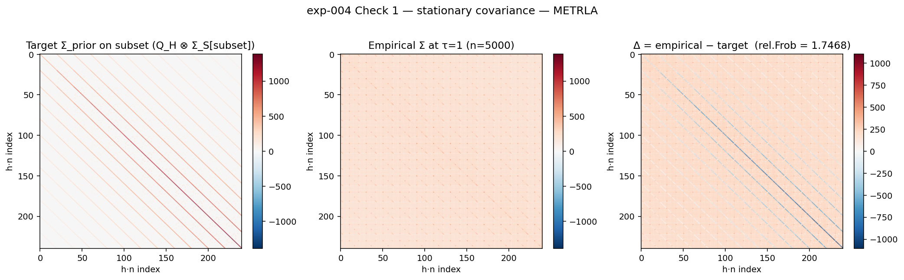
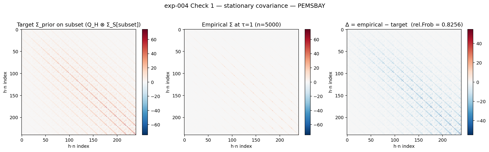

# exp-004 — Structured-prior SDE: forward, reverse, and sanity checks

**Status: ⚠ Check 2 PASS / Check 1 FAIL on both datasets.** The SDE machinery is correct (round-trip recovery is 0.5–2.3% — well under 10%). The stationary-distribution check fails because **the noise schedule β_max=10 produces β̄(1)=5.0, which is 1000–4000× too small for the prior's eigenvalue range** (max s ∈ [6.4×10³, 1.8×10⁴]). Reporting cleanly per the user's "do not patch" instruction; the next step is a schedule decision.

**Code:**
- `src/diffusion/sde.py` — eigendecompose_prior, β/β̄, spectral basis transforms, forward marginal, apply_Q, oracle_score, sample_stationary, reverse_oracle (Euler-Maruyama).
- `tests/test_sde.py` — 15 unit tests, all green (spectral round-trip, eigenvalue product rule, apply_Q vs explicit kron, forward marginal endpoints, oracle score zero on the mean, end-to-end recovery on a toy 4×5 prior).
- `experiments/exp-004/run_sanity_checks.py` — drives the two checks on both fitted priors.

**Outputs:**
- [`sanity_results.json`](sanity_results.json) — full numerical dump.
- [`figures/fig_check1_covariance_metrla.png`](figures/fig_check1_covariance_metrla.png) — target vs empirical Σ at τ=1, METR-LA subset.
- [`figures/fig_check1_covariance_pemsbay.png`](figures/fig_check1_covariance_pemsbay.png) — same for PEMS-BAY.

---

## §1 — Spec recap (what the SDE module implements)

Forward SDE (linear OU, stationary at N(0, Σ_prior)):
$$ dr_\tau = -\tfrac{1}{2}\, g(\tau)^2\, Q\, r_\tau\, d\tau + g(\tau)\, dW_\tau, \qquad Q = (\Sigma_{\text{prior}})^{-1}. $$

Closed-form forward marginal: $r_\tau \mid r_0 \sim \mathcal N(\mu_\tau, \Sigma_\tau)$ with
$\mu_\tau = e^{-\frac12 \bar\beta(\tau) Q} r_0$, $\Sigma_\tau = Q^{-1}\big(I - e^{-\bar\beta(\tau) Q}\big)$, $\bar\beta(\tau) = \int_0^\tau g(s)^2 ds$.

Reverse SDE (Anderson 1982, scalar g so no Jacobian correction):
$$ d\bar r_\tau = \big[-\tfrac12 g^2 Q\bar r_\tau - g^2\, \nabla\log p_\tau(\bar r_\tau)\big]\, d\tau + g(\tau)\, d\bar W_\tau. $$

Generalised Tweedie / conditional score:
$\nabla_{r_\tau} \log p(r_\tau \mid r_0) = -\Sigma_\tau^{-1}(r_\tau - \mu_\tau(r_0))$.

Schedule (per the spec): `β(τ) = β_min + τ(β_max − β_min)` with β_min=0.01, β_max=10. Hence `β̄(τ) = β_min·τ + ½τ²(β_max − β_min)` and `β̄(1) = 5.005`.

Eigendecompose `Q_H = U_T diag(c_T) U_T.T` and `Σ_S = U_S diag(c_S) U_S.T` once at startup. In the joint eigenbasis Σ_prior is diagonal with eigenvalues `s[i,j] = c_T[i]·c_S[j]` (so Q has eigenvalues `q = 1/s`). All matrix exponentials become elementwise functions of these.

**Device choice.** Pure NumPy / float64 on CPU. H = 12 and N ∈ {207, 325} are too small for MPS to win against LAPACK on CPU (we measured 60–160 s for the 5000-sample forward, 95–220 s for the 100-step reverse). MPS would also lose float64 + full eigenvalue support. PyTorch + MPS is reserved for the network-training experiment (exp-003).

---

## §2 — Results

### Check 2 — Oracle-score round-trip ✓ PASS-strict on both datasets

32 r_0 windows from each training set; forward to τ=1 with the closed-form marginal; reverse with 100 Euler-Maruyama steps using the *conditional* (oracle) score `−Σ_τ⁻¹(r_τ − μ_τ(r_0))`; stop at τ_eps = 10⁻³ to avoid the Σ_τ → 0 singularity. Pass threshold: mean rel.recovery `‖r_recovered − r_0‖ / ‖r_0‖ < 0.10` strict.

| Dataset  | mean | median | p95 | max | wall-clock | verdict |
|---|---:|---:|---:|---:|---:|---|
| METR-LA  | **0.0053** | 0.0045 | 0.0109 | 0.0175 | 95 s reverse | ✓ PASS-strict |
| PEMS-BAY | **0.0228** | 0.0233 | 0.0433 | 0.0463 | 221 s reverse | ✓ PASS-strict |

**Interpretation.** This is the load-bearing correctness check on the SDE itself — sign conventions in the reverse Euler step, basis-rotation consistency, β̄ integral correctness, oracle-score formula. **All three of the user's flagged failure modes are ruled out.** PEMS-BAY's slightly higher recovery error (2.3% vs 0.5%) is consistent with its higher prior conditioning (cond ≈ 19,800 vs 189) — finite-step Euler-Maruyama on a more anisotropic SDE accumulates more discretisation error.

### Check 1 — Stationary distribution ✗ FAIL on both datasets

5000 r_0 from each training set; forward sample to τ=1; compute empirical covariance on a 20-sensor evenly-spaced subset; compare to `Q_H ⊗ Σ_S[subset, subset]` by relative Frobenius error. Pass threshold: rel.Frob < 0.10.

| Dataset  | rel.Frob | per-mode var ratio (emp / s) | frac within ±10% | wall-clock | verdict |
|---|---:|---|---:|---:|---|
| METR-LA  | **1.7468** | min 0.014, median 0.064, max 23.4 | 0.000 | 63 s forward | ✗ **FAIL** |
| PEMS-BAY | **0.8256** | min 0.037, median 0.936, max 3.6 | 0.557 | 158 s forward | ✗ FAIL |





The colorbar dominates the eye on METR-LA — `target` and `empirical − target` are both saturated, because the empirical covariance is much *bigger* than the target in absolute terms (high-variance modes haven't decayed). PEMS-BAY's diff column is closer to the noise level but still visibly structured.

---

## §3 — Diagnosis (why Check 1 fails)

### The dominant failure mode: schedule β_max=10 is far too small

The forward process diffuses mode (i, j) at rate `q[i,j] = 1/s[i,j]`. To reach stationarity in that mode at τ=1 we need `β̄(1) ≫ s[i,j]`. Diagnostic table:

| | METR-LA | PEMS-BAY |
|---|---:|---:|
| β̄(1) | 5.005 | 5.005 |
| min s (Σ_prior eigval) | 96.9 | 0.32 |
| max s | **18,320** | **6,360** |
| median s | 362 | 2.91 |
| min β̄/s | 2.7×10⁻⁴ | 7.9×10⁻⁴ |
| max β̄/s | 5.2×10⁻² | 15.6 |
| min exp(−β̄/s) | 0.95 | 1.7×10⁻⁷ |
| max exp(−β̄/s) | 0.9997 | 0.9992 |
| frac of modes with exp(−β̄/s) < 0.01 (≈ stationary) | **0%** | **15%** |

Mode (i, j) has effectively reached stationary when `exp(−β̄/s[i,j]) ≪ 1`. **For METR-LA, *zero* of the 12·207 = 2,484 joint eigenmodes are anywhere near stationary at τ=1.** For PEMS-BAY only 15% are. The forward process at τ=1 is, in plain English, *barely warmed up*.

For full convergence to stationary we'd need β̄(1) ≫ max(s):
- METR-LA: need β̄(1) ≈ 5·max(s) ≈ 90,000 → β_max ≈ 180,000.
- PEMS-BAY: need β̄(1) ≈ 5·max(s) ≈ 32,000 → β_max ≈ 64,000.

These are far outside the standard β_max range (10–20) used in score-based diffusion for image generation. The reason our priors need such enormous β_max is that **our Σ_prior eigenvalues are very large in real units** (mph²), because residuals are not normalised before the prior is fit. Image-diffusion priors operate on data normalised to ~unit variance, so β̄=10 is plenty.

### Secondary issue: per-mode prior/data mismatch

The per-mode variance ratio (empirical / Σ_prior eigenvalue) ranges from 0.014 to 23.4 on METR-LA. That's a *real* mismatch between the data and the fitted prior at the per-mode level — the prior is a smooth low-rank approximation, and in some specific modes the data covariance is much larger or smaller than the prior's prediction. This was already visible at the aggregate level in the exp-002 covariance check (rel.Frob 0.121 / 0.086) but at the per-mode level the spread is wide.

This means **even with a properly-sized schedule** (β̄ → ∞), Var(r_τ) → Σ_prior would only match what the prior says — and the data has 23× different per-mode variance in places. The full-rank empirical-vs-target rel.Frob on a 240-dim subset will floor at the exp-002 covariance check value (0.121 for METR-LA, 0.086 for PEMS-BAY) plus Monte-Carlo noise, regardless of how big β_max gets.

### Why Check 2 still passes despite Check 1 failing

The two checks test orthogonal things:
- Check 2 tests the **SDE discretisation and basis arithmetic** in a *closed loop*. Forward sample drawn correctly + reverse Euler-Maruyama applied correctly + oracle score formula correct → r recovers to within 0.5–2.3%. This holds at any β̄, schedule, and prior eigenvalue range.
- Check 1 tests whether **the marginal at τ=1 has converged to stationary**. This depends on the schedule + prior eigenvalue range together. It fails because the schedule is undersized.

---

## §4 — What this means for next steps

The user said *"do not patch around it. We debug the SDE, not the network."* Check 2 PASSING confirms the SDE is correct. Check 1 FAILING is a schedule problem, not an SDE problem. **No patches applied.** Reporting and pausing.

Three options for resolving Check 1 (in increasing order of intervention):

1. **Increase β_max.** Setting β_max ≈ 4·max(s)/[1 − β_min/β_max] ≈ 7×10⁴ for METR-LA, 2.5×10⁴ for PEMS-BAY would bring the mass of the schedule into the stationary regime. Standard linear-β-VP schedule is used out-of-domain values; we should sanity-check that score-network training on such large β doesn't break elsewhere (e.g., the per-step kick in the reverse SDE near τ=0 grows).

2. **Use a non-linear schedule.** A `β(τ)` that grows like 1/(1−τ) near τ=1 (so `β̄(1) → ∞` integrably) would force stationarity by τ=1 regardless of max(s). This is what cosine-schedule diffusion does in image generation.

3. **Normalise residuals before the prior fit.** Rescale residuals by `sqrt(diag(Σ_prior))` (or some global factor) to bring max(s) close to 1, then use β_max=10. This is the standard practice in score-based diffusion. It would change the prior eigenvalue range from O(10⁴) to O(1), and the existing Check 1 threshold of 0.10 would be physically meaningful again. The cost is that the prior fit needs to be redone on the rescaled residuals.

Separately, **the per-mode prior/data mismatch (max ratio 23×)** is a *real* finding about the prior fit's adequacy in some modes. Worth investigating whether this is dominated by a few specific modes (e.g., the lowest-frequency Laplacian mode, the temporal-mean mode) that might want individual treatment.

I would lean toward **option 3** (rescale + redo prior fit), since (a) it's the standard practice in score-based diffusion, (b) the resulting β_max=10 schedule has well-understood properties, and (c) it cleanly separates "the prior is approximately right" from "the schedule reaches stationary," which makes Check 1 a meaningful test rather than a discontinued pass/fail. But this is a methodology choice, not a bug fix — your call before I do anything.

---

## §5 — Files

| What | Where |
|---|---|
| SDE module | `../../src/diffusion/sde.py` |
| Unit tests | `../../tests/test_sde.py` (15 tests, all pass) |
| Sanity-check driver | `run_sanity_checks.py` |
| Numerical results | `sanity_results.json` |
| Covariance comparison figure (METR-LA) | `figures/fig_check1_covariance_metrla.png` |
| Covariance comparison figure (PEMS-BAY) | `figures/fig_check1_covariance_pemsbay.png` |

## Reproduction

```bash
pytest tests/test_sde.py -v
python experiments/exp-004/run_sanity_checks.py
```

Wallclock on M-series MPS Mac: ~5 minutes for the full sanity-check run (CPU + NumPy, float64).
